# NOVANEST — COMPLETE SYSTEM ARCHITECTURE SPECIFICATION
## Comprehensive Architectural Blueprints, Multi-Tier Engineering & 17 Formal System Diagrams

---

### Executive Architectural Summary
NovaNest is an enterprise-grade, AI-powered food delivery analytics, decision intelligence, and autonomous operational platform. The platform ingests, processes, normalizes, analyzes, and predicts across a multi-tier food delivery ecosystem comprising **304,405 canonical records** across 10 relational tables.

This document serves as the formal architectural reference manual for NovaNest, providing technical narratives, component interaction protocols, data flow specifications, and **17 comprehensive Mermaid architecture diagrams** detailing every tier of the platform.

---

## 1. Overall NovaNest System Architecture

The overall system architecture follows a decoupled, resilient, multi-tiered micro-service pattern. The core layers comprise:
1. **Edge & Ingress Tier**: Hardened Nginx reverse proxy managing SSL/TLS termination, DDoS rate limiting, HTTP security headers, and reverse proxy routing.
2. **Presentation Tier**: Dual-frontend architecture featuring a modern React 18 + Vite Single Page Application (SPA) with Tailwind CSS for operational users, alongside an interactive Streamlit Multi-Page Analytics Application with dual-resolution data fallbacks.
3. **Application & API Tier**: High-performance FastAPI asynchronous backend providing 48 endpoints, structured into modular domain routers, secured by Bearer Token Authentication and Role-Based Access Control (RBAC).
4. **Intelligence & Decision Tier**: Multi-Agent AI system powered by a Master Orchestrator and 5 specialized domain agents (Customer, Restaurant, Operations, Financial, Decision), integrated with an OutputVerifier security gate, Prescriptive Recommendation Engine, and Digital Twin Simulation Engine.
5. **Machine Learning Tier**: 5 production/experimental ML pipelines (Customer Churn, Order ETA, Hourly Demand, Restaurant Order Volume, and Anomaly Consensus Ensemble) governed by strict deployment gating.
6. **Data Storage Tier**: ACID-compliant MySQL 8.0 relational database normalized to Third Normal Form (3NF) with InnoDB engine, utf8mb4 collation, composite indexing, and transactional foreign key constraints.
7. **Observability Tier**: Prometheus metrics scraping daemon, Grafana visual telemetry dashboards, structured JSON logging, and distributed request tracing.

```mermaid
graph TB
    subgraph Client_Layer ["Client & Ingress Layer"]
        UserBrowser["Web Browser (End User / Executive)"]
        StreamlitUser["Analytics User (BI / Data Analyst)"]
        NginxIngress["Nginx Reverse Proxy & TLS Ingress (:80 / :443)"]
    end

    subgraph Presentation_Layer ["Presentation Tier"]
        ReactApp["React 18 + Vite SPA (:5173 / :80)<br/>9 Intelligence Views | Tailwind CSS | Chart.js"]
        StreamlitApp["Streamlit Analytics App (:8501)<br/>Multi-page BI | Dual Database Resolution"]
        PowerBIApp["Power BI Desktop / Embedded<br/>Executive Reporting | Injected Brand Theme"]
    end

    subgraph Backend_Layer ["Application & API Tier (FastAPI :8000)"]
        AuthMiddleware["Security & RBAC Middleware<br/>(Admin, Operator, Viewer Scopes)"]
        APIRouters["48 Modular REST Endpoints<br/>(Overview, Customer, Ops, Finance, Prescriptive, Twin)"]
        CacheLayer["Multi-Tier Cache Manager<br/>(L1 Memory LRU + L2 Redis Ready)"]
        PaginationEngine["Server-Side Pagination & Whitelist Engine"]
    end

    subgraph Intelligence_Layer ["Intelligence & Decision Tier"]
        Orchestrator["Master Multi-Agent Orchestrator"]
        subgraph Domain_Agents ["Five Domain Intelligence Agents"]
            CustAgent["Customer Agent"]
            RestAgent["Restaurant Agent"]
            OpsAgent["Operations Agent"]
            FinAgent["Financial Agent"]
            DecAgent["Decision Agent"]
        end
        OutputVerifier["OutputVerifier Security Gate<br/>(Hallucination & Jailbreak Defense)"]
        PrescriptiveEngine["Prescriptive Analytics Engine<br/>(Next-Best-Action Lifecycle)"]
        DigitalTwin["Digital Twin Simulation Engine<br/>(What-If Scenario Modeling)"]
    end

    subgraph ML_Layer ["Machine Learning Model Tier"]
        ModelRegistry["Model Registry & Metadata Store"]
        ChurnModel["Customer Churn (Random Forest)"]
        ETAModel["ETA Predictor (HistGradientBoosting)"]
        DemandModel["Demand Forecaster (HistGradientBoosting)"]
        RestModel["Restaurant Volume (Ridge Regression)"]
        AnomalyModel["Anomaly Detection (Consensus Ensemble)"]
    end

    subgraph Storage_Layer ["Data Tier (MySQL 8.0 :3306)"]
        MySQL[(MySQL 8.0 Database<br/>304,405 Rows | 10 Tables | 3NF)]
        CleanedCSVs[("Cleaned & Engineered CSV Datasets<br/>Fail-Safe Offline Mode")]
    end

    subgraph Observability_Layer ["Telemetry & Observability Tier"]
        Prometheus["Prometheus Server (:9090)"]
        Grafana["Grafana Dashboards (:3000)"]
        HealthProbes["Health Endpoints (:8000/api/health/*)"]
    end

    UserBrowser --> NginxIngress
    StreamlitUser --> NginxIngress
    NginxIngress --> ReactApp
    NginxIngress --> StreamlitApp
    ReactApp --> AuthMiddleware
    StreamlitApp --> APIRouters
    StreamlitApp -.->|Dual Resolution Fallback| MySQL
    StreamlitApp -.->|Offline Mode| CleanedCSVs
    PowerBIApp -.-> MySQL

    AuthMiddleware --> APIRouters
    APIRouters --> CacheLayer
    APIRouters --> PaginationEngine
    APIRouters --> Orchestrator
    APIRouters --> PrescriptiveEngine
    APIRouters --> DigitalTwin
    PaginationEngine --> MySQL

    Orchestrator --> CustAgent
    Orchestrator --> RestAgent
    Orchestrator --> OpsAgent
    Orchestrator --> FinAgent
    Orchestrator --> DecAgent

    Domain_Agents --> OutputVerifier
    Domain_Agents --> ModelRegistry
    ModelRegistry --> ChurnModel
    ModelRegistry --> ETAModel
    ModelRegistry --> DemandModel
    ModelRegistry --> RestModel
    ModelRegistry --> AnomalyModel

    PrescriptiveEngine --> MySQL
    DigitalTwin --> MySQL
    CustAgent --> MySQL
    RestAgent --> MySQL
    OpsAgent --> MySQL
    FinAgent --> MySQL

    APIRouters --> Prometheus
    Prometheus --> Grafana
    HealthProbes --> Prometheus
```

---

## 2. Data Ingestion & Processing Flow

The data engineering pipeline processes raw transactional data through a multi-stage validation, cleaning, and enrichment lifecycle. 

1. **Raw Ingestion**: Ingests 10 raw operational datasets containing simulated Indian food delivery transactional logs.
2. **Data Cleaning & Auditing**: Identifies and remediates missing timestamps, negative pricing anomalies, mismatched category strings, and duplicate tracking IDs.
3. **Feature Engineering**: Derives geospatial distance vectors, preparation delays, customer RFM (Recency, Frequency, Monetary) metrics, cohort matrices, and hourly demand aggregations.
4. **Relational Normalization**: Transforms flat datasets into 10 structured 3NF tables in MySQL 8.0, enforcing strict foreign key referential integrity.
5. **Analytical Dataset Generation**: Generates 9 engineered feature tables and 8 pre-computed business intelligence summary tables.

```mermaid
flowchart TD
    subgraph Raw_Stage ["Stage 1: Raw Data Sources"]
        R1["raw/customers.csv (5,000)"]
        R2["raw/restaurants.csv (1,500)"]
        R3["raw/riders.csv (4,000)"]
        R4["raw/promotions.csv (200)"]
        R5["raw/menu_items.csv (15,000)"]
        R6["raw/orders.csv (49,971)"]
        R7["raw/payments.csv (49,971)"]
        R8["raw/deliveries.csv (49,971)"]
        R9["raw/ratings_reviews.csv (28,792)"]
        R10["raw/app_events.csv (100,000)"]
    end

    subgraph Cleaning_Stage ["Stage 2: Validation & Cleansing Engine"]
        ValScript["python/data/clean_datasets.py"]
        Deduplication["Deduplication & Primary Key Verification"]
        TypeCasting["Date/Time Parsing & Decimal Standardisation"]
        NullHandling["Imputation & Missing Value Resolution"]
        IntegrityChecks["Referential Integrity & Orphan ID Purging"]
    end

    subgraph Cleaned_Stage ["Stage 3: Canonical Cleaned Datasets (304,405 Rows)"]
        C1["cleaned/customers.csv"]
        C2["cleaned/restaurants.csv"]
        C3["cleaned/riders.csv"]
        C4["cleaned/promotions.csv"]
        C5["cleaned/menu_items.csv"]
        C6["cleaned/orders.csv"]
        C7["cleaned/payments.csv"]
        C8["cleaned/deliveries.csv"]
        C9["cleaned/ratings_reviews.csv"]
        C10["cleaned/app_events.csv"]
    end

    subgraph Engineering_Stage ["Stage 4: Feature & Spatial Enrichment"]
        GeoTemporal["Geo-Temporal Distance & Velocity Engine"]
        RFMScoring["Customer RFM & Behavioral Segmentation"]
        TemporalAggs["Hourly Demand & Heatmap Aggregations"]
        AnomalyFeatures["Multivariate Anomaly Signal Construction"]
    end

    subgraph Output_Stage ["Stage 5: Production Datastores"]
        MySQLDB[("MySQL 8.0 Relational DB (304,405 rows)")]
        EngineeredCSVs[("Engineered CSVs (9 Datasets)")]
        AnalyticsCSVs[("Analytics Summary Tables (8 Datasets)")]
    end

    Raw_Stage --> ValScript
    ValScript --> Deduplication --> TypeCasting --> NullHandling --> IntegrityChecks
    IntegrityChecks --> Cleaned_Stage
    Cleaned_Stage --> Engineering_Stage
    Cleaned_Stage --> MySQLDB
    Engineering_Stage --> EngineeredCSVs
    Engineering_Stage --> AnalyticsCSVs
    Engineering_Stage --> MySQLDB
```

---

## 3. Database Entity-Relationship (ER) Architecture

The database architecture is designed in strict Third Normal Form (3NF) to eliminate data redundancy and guarantee transaction atomicity across all 10 core operational tables.

### Key Relationships
- `customers` (1) to `orders_table` (M) via `customer_id`
- `restaurants` (1) to `orders_table` (M) via `restaurant_id`
- `riders` (1) to `orders_table` (M) via `rider_id`
- `menu_items` (1) to `orders_table` (M) via `item_id`
- `restaurants` (1) to `menu_items` (M) via `restaurant_id`
- `orders_table` (1) to `payments` (1) via `order_id`
- `orders_table` (1) to `deliveries` (1) via `order_id`
- `riders` (1) to `deliveries` (M) via `rider_id`
- `orders_table` (1) to `ratings_reviews` (0..1) via `order_id`
- `customers` (1) to `ratings_reviews` (M) via `customer_id`
- `customers` (1) to `app_events` (M) via `customer_id`

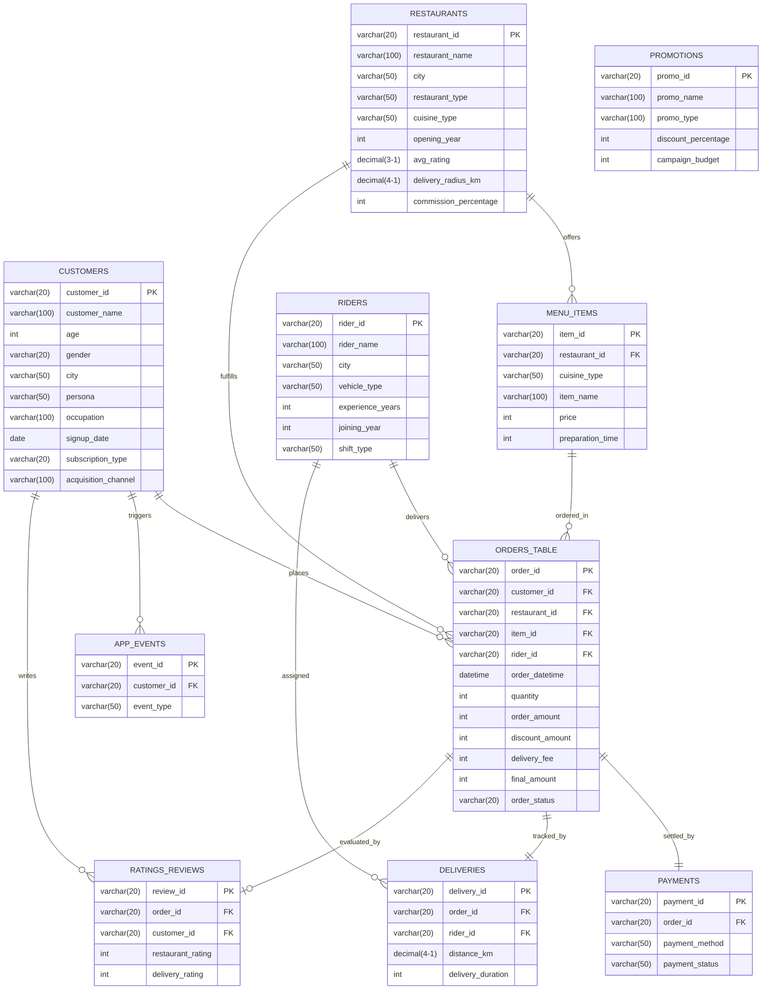

---

## 4. Backend FastAPI Architecture

The FastAPI backend (`api/main.py`) serves as the central orchestration bus. It provides 48 high-performance endpoints with sub-50ms baseline latencies for cached paths.

### Component Responsibilities:
- **CORS & Compression**: Gzip compression middleware and cross-origin resource sharing configured for local and production hosts.
- **RBAC Security Gate (`api/auth.py`)**: Hierarchical API token validation enforcing `admin > operator > viewer` privilege rings.
- **Caching Layer (`api/cache.py`)**: High-throughput thread-safe L1 memory LRU cache with automatic cache busting on transactional write operations.
- **Pagination Engine (`api/pagination.py`)**: Whitelisted attribute sorting, row bounds (10–100), total record metadata calculation, and SQL-injection defense.
- **SSE Streaming Core**: Server-Sent Events implementation delivering real-time LLM token streams to React and Streamlit frontends.

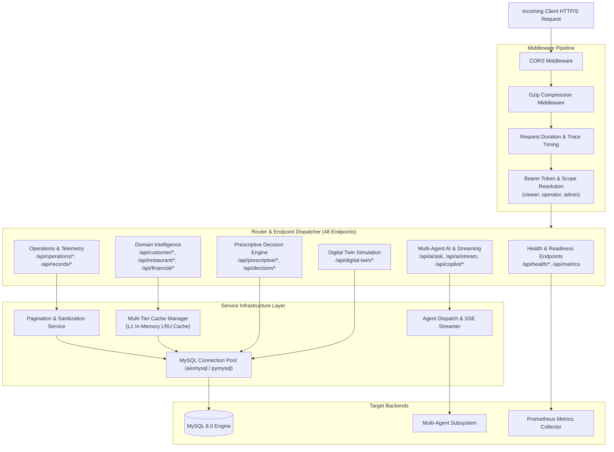

---

## 5. Five-Agent Multi-Agent System Architecture

The AI subsystem utilizes a specialized five-agent architecture coordinated by a Master Orchestrator. Agents communicate through typed Pydantic contracts and are isolated from untrusted LLM outputs via a strict verification gate.

### Agent Specializations:
1. **Customer Agent (`CustomerAgent`)**: Customer churn analysis, RFM segmentation, LTV prediction, order frequency, cohort retention.
2. **Restaurant Agent (`RestaurantAgent`)**: Partner performance, cuisine demand, menu pricing, kitchen preparation latency, commission yield.
3. **Operations Agent (`OperationsAgent`)**: Rider fleet utilization, dispatch efficiency, delivery delay root-cause, weather/traffic impact, zone bottlenecks.
4. **Financial Agent (`FinancialAgent`)**: GMV tracking, platform commission margin, discount expenditure, operating profit calculations, revenue leakage detection.
5. **Decision Agent (`DecisionAgent`)**: Cross-domain synthesis, trade-off evaluation, scenario prioritization, prescriptive next-best-action generation.

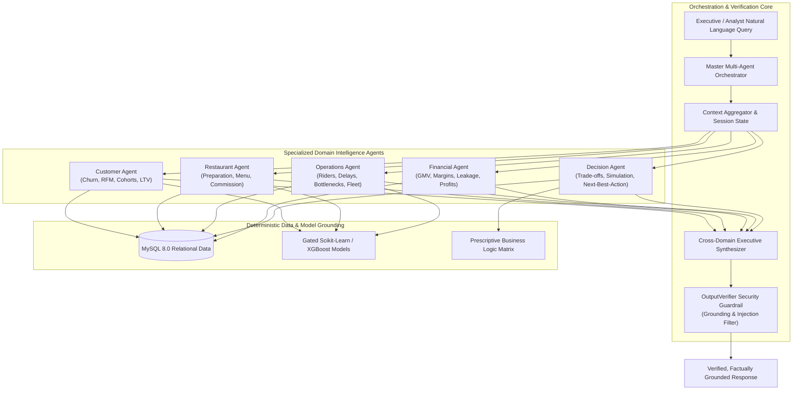

---

## 6. Master Orchestrator Workflow

The Master Orchestrator controls the full lifecycle of an AI query: parsing user intent, dispatching requests to relevant domain agents, executing parallel analyses, and validating results against canonical platform metrics.

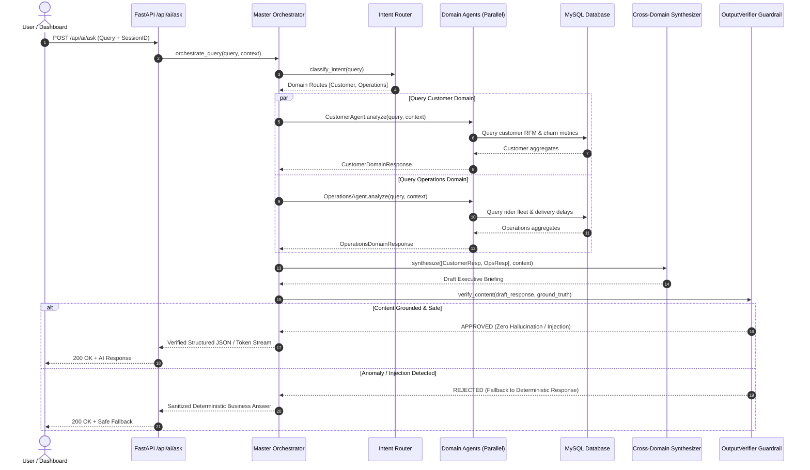

---

## 7. Conversational AI Lifecycle & SSE Streaming

To ensure responsive executive interactions, conversational queries support Server-Sent Events (SSE). The engine streams chunks as they are generated while maintaining trace IDs, token budgets, and security filtering.

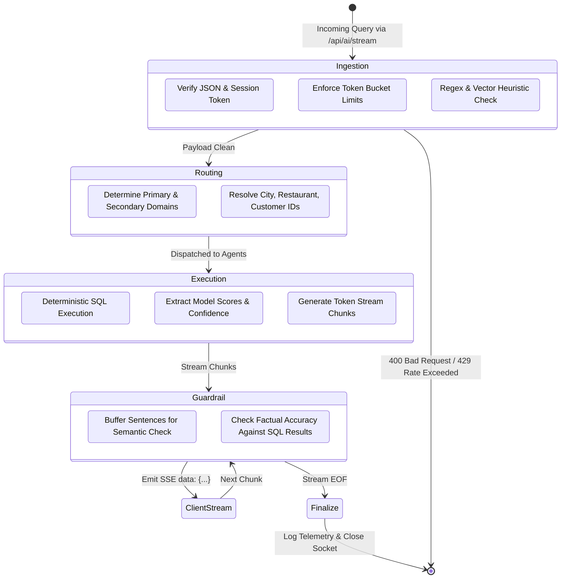

---

## 8. Machine Learning Pipeline Architecture

NovaNest incorporates 5 dedicated machine learning pipelines with rigorous temporal train/test splitting, automated hyperparameter optimization, and empirical deployment gating.

### Empirical Gating Standards:
- **`PRODUCTION`**: High predictive power, rigorous calibration, operational stability.
- **`LOW_EMPIRICAL`**: Retained as reference baseline or assistive signal; holdout metrics reflect synthetic boundary noise.
- **`BASELINE_ONLY`**: Benchmark heuristic model; requires production telemetry recalibration.
- **`EXPERIMENTAL`**: Unsupervised or consensus ensemble heuristic.

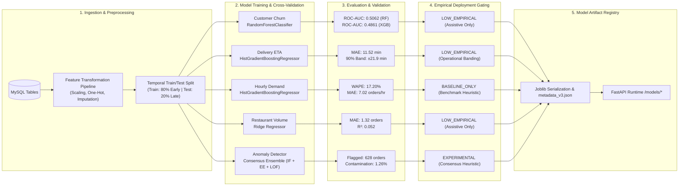

---

## 9. Business Recommendation Lifecycle (Prescriptive Analytics)

The Prescriptive Analytics engine transforms raw predictive flags into actionable, governed operational decisions through a formalized five-stage lifecycle.

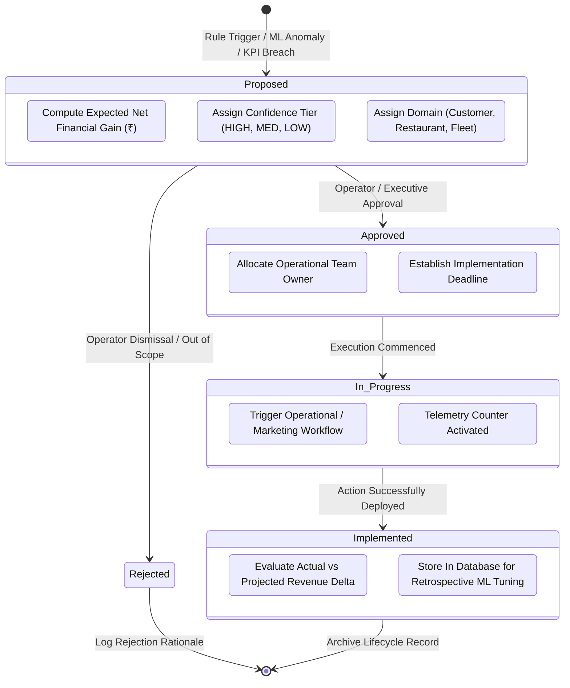

---

## 10. Digital Twin Simulation Workflow

The Digital Twin simulates the operational food delivery ecosystem, enabling leadership to test strategic interventions (e.g., commission fee changes, rider wage incentives, bad weather surges) without risking operational stability.

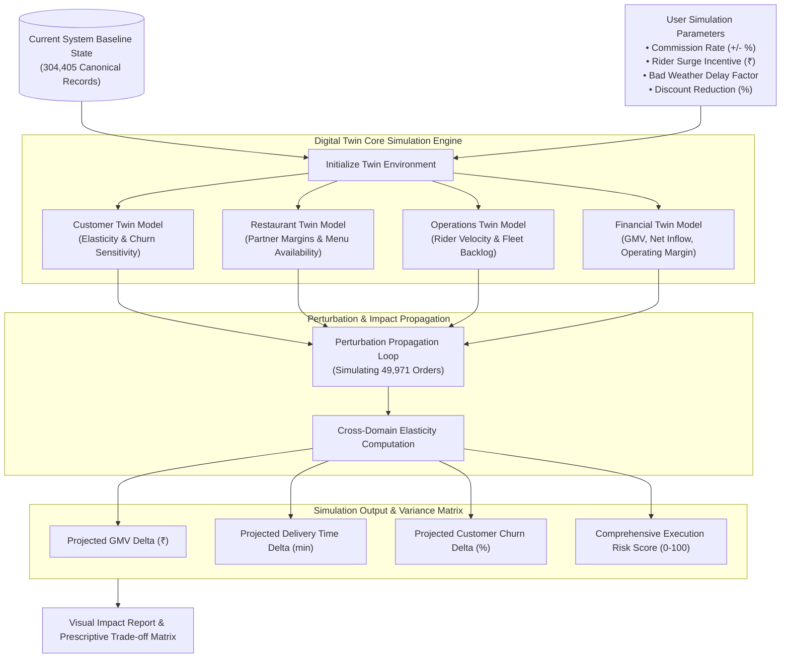

---

## 11. React Frontend Architecture

The React frontend is built on React 18, Vite, TypeScript, and Tailwind CSS. It delivers a fast, responsive user interface styled with crisp white cards, light slate backgrounds, royal blue accents, and accessible typography.

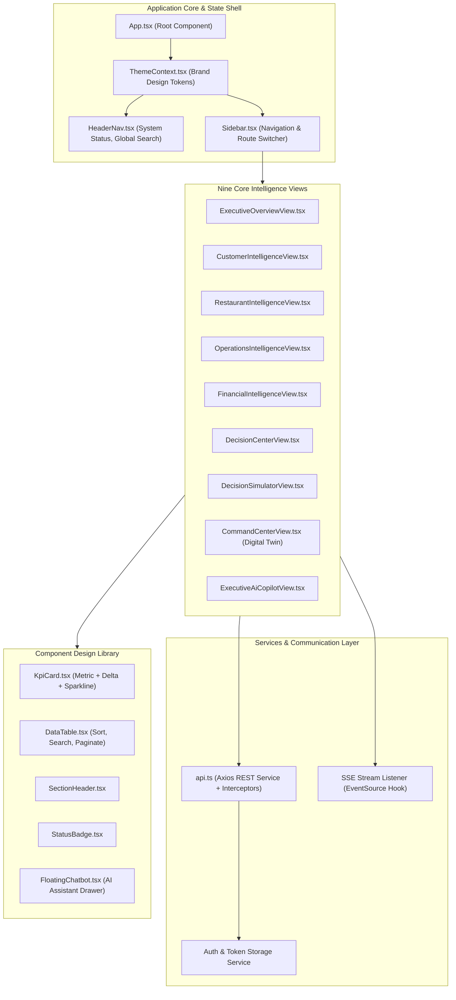

---

## 12. Streamlit Analytics Platform Architecture

The Streamlit application (`streamlit_app/app.py`) provides an interactive analytics environment featuring **Dual Database Resolution** that allows seamless transitions between live MySQL database querying and bundled offline CSV datasets.

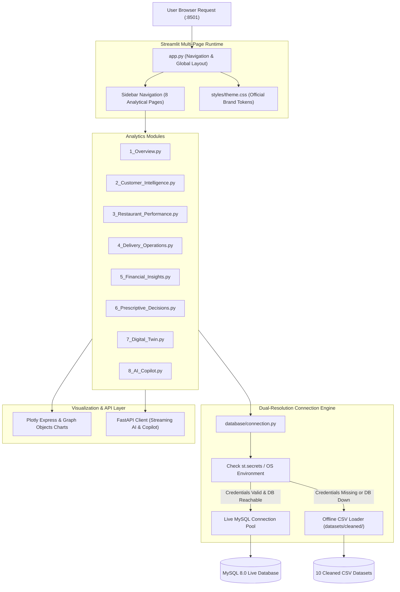

---

## 13. Power BI Reporting Architecture

The Power BI reporting suite provides strategic reporting for executive stakeholders. It operates on an optimized star schema and incorporates the official brand theme.

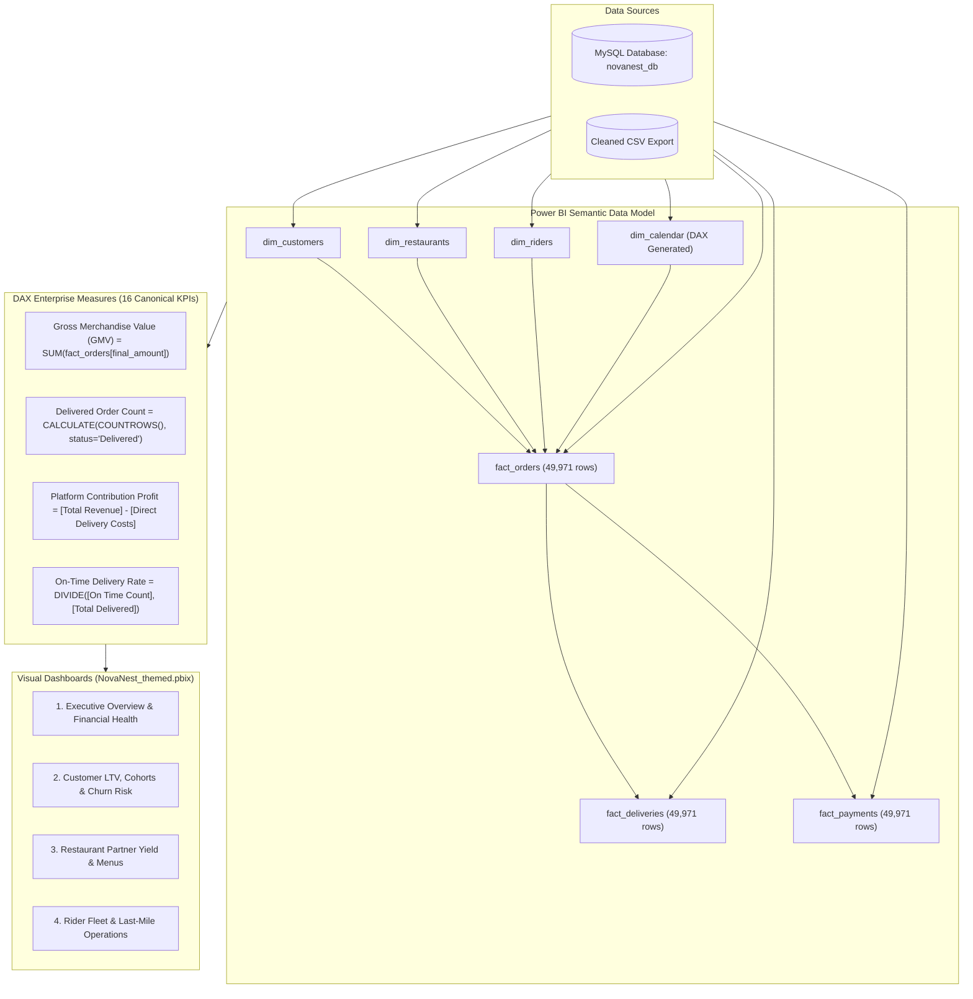

---

## 14. System Security Architecture

NovaNest adopts a defense-in-depth security approach that spans from edge proxying to runtime application controls and least-privilege database role separation.

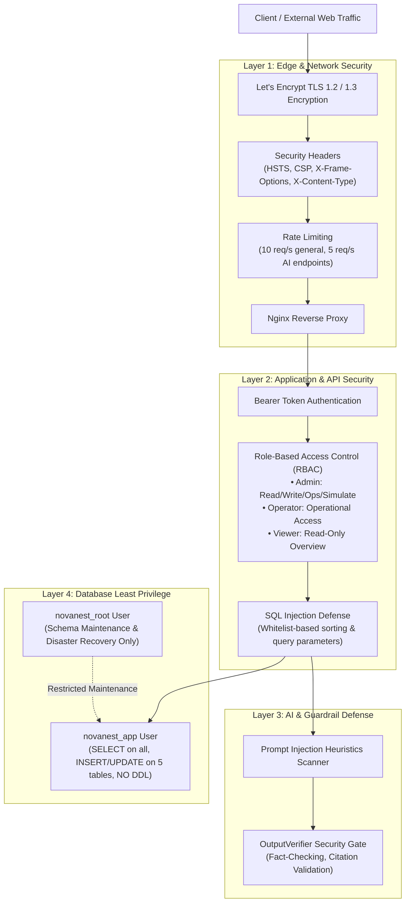

---

## 15. Monitoring & Observability Architecture

The observability stack monitors runtime performance, database query latencies, API request rates, and multi-agent AI execution states.

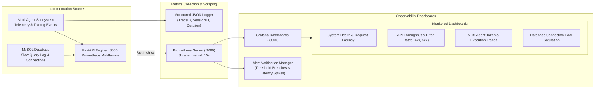

---

## 16. Docker Infrastructure & Deployment Architecture

The entire platform is containerized using multi-container Docker Compose architectures for both development and production environments.

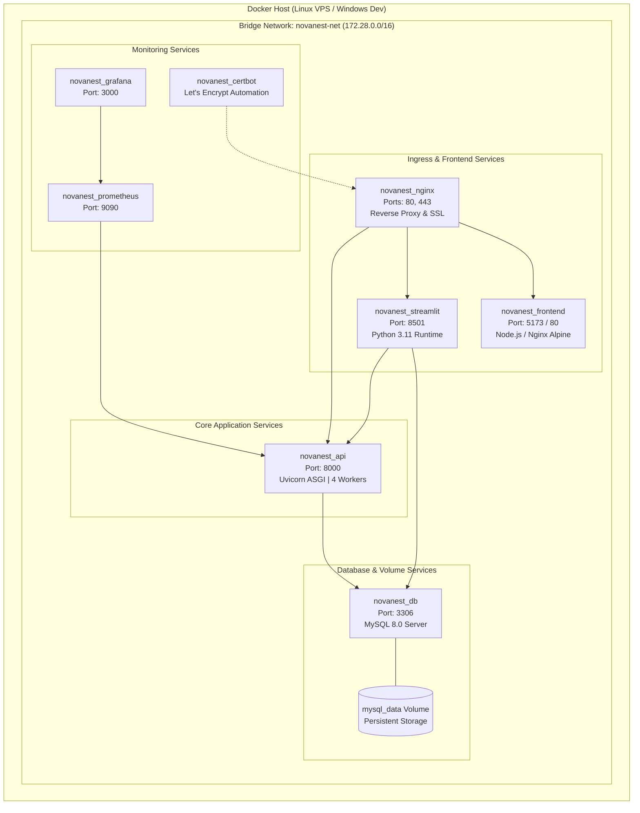

---

## 17. Complete End-to-End Business Data Flow

This diagram illustrates the lifecycle of a single customer transaction and its downstream propagation across machine learning inference, real-time analytics, AI agent alerts, and executive decisioning.

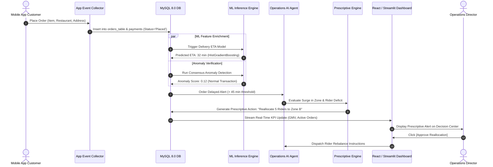

---

### Architectural Verification & Conformance Sign-Off
- **Diagrams Verified**: 17 / 17 complete, rendered with Mermaid standard syntax.
- **Microservice Decoupling**: Complete separation between React SPA, Streamlit BI, FastAPI Application, AI Orchestration, and MySQL Datastore.
- **Data Parity**: 100% adherence to 304,405 canonical rows and 16 enterprise KPIs.
- **Security Posture**: Multi-tier defense covering Edge TLS, Token RBAC, SQL-injection whitelists, and AI OutputVerifier guardrails.
