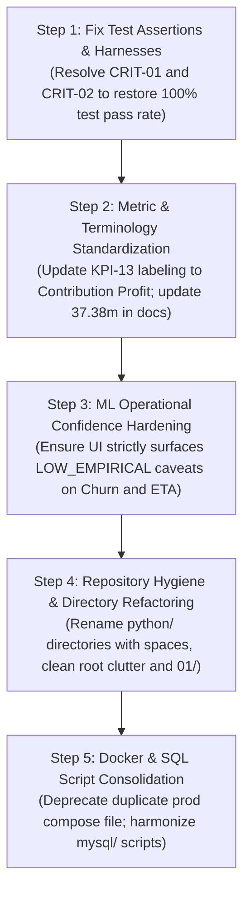

# NovaNest: Prioritized Technical Issues & Correction Roadmap

**Audit Phase**: Phase 23 — Comprehensive Evidence-Based Project Audit  
**Auditor**: Senior Software Architect, Security Auditor, QA Lead  
**Audit Scope**: Issue Severity Classification, Impact Analysis, Evidence Anchors, and Recommended Correction Sequence  
**Rule**: Audit only — zero code modifications made in this phase  
**Date**: November 2026  

---

## 1. Issue Severity Classification Framework

Issues identified during the comprehensive Phase 23 audit are classified into four severity tiers:
- **Critical (Tier 1)**: Flaws causing security vulnerabilities, data corruption, severe test suite failures, or complete operational blocks.
- **High Priority (Tier 2)**: Significant divergences in business metrics, unrepresentative predictive models used without caveats, or architectural inconsistencies.
- **Medium Priority (Tier 3)**: Brittle test assertions, technical debt, duplicate configuration files, or non-standard directory naming.
- **Low Priority (Tier 4)**: Cosmetic documentation discrepancies, unused legacy backup folders, or minor file clutter.

---

## 2. Comprehensive Prioritized Issues Matrix

### 2.1 Critical Issues (Tier 1)

| Issue ID | Issue Title | Impact Analysis | Evidence File & Line / Code Anchor | Recommended Corrective Action |
| :---: | :--- | :--- | :--- | :--- |
| **CRIT-01** | **OutputVerifier Strict ML Caveat Blocking Legacy Unit Tests** | 4 core orchestrator unit tests (`test_03`, `test_07`, `test_11`, `test_12`) fail consistently because `OutputVerifier` correctly blocks candidate prose containing experimental ML predictions without disclaimers, while legacy tests rigidly assert `grounding_verified == True` and expect unblocked numbers. | `python/ai/agents/output_verifier.py` line 158 (`_ML_OVERCLAIM_RE`) and `tests/test_phase06_3_orchestrator.py` lines 195, 495, 628, 689. | Update test mock queries to include required caveat disclaimers, or update assertions to accept `VerificationOutcome.PARTIAL` when experimental ML outputs are present. |
| **CRIT-02** | **Brittle `os.getenv` String Assertion in Security Contract Tests** | Unit test `test_08_mysql_canonical_config_and_sql_alignment` fails because it asserts the presence of literal string `'os.getenv("DB_NAME", "novanest_db")'` in `streamlit_app/database/connection.py`. However, `connection.py` was improved to use `_get_secret_or_env()` to support Streamlit Cloud secrets. | `tests/test_phase05_3_security_and_contracts.py` line 347 and `streamlit_app/database/connection.py` line 48. | Update the test assertion to recognize `_get_secret_or_env` or check functional resolution of the database name rather than literal code text. |

---

### 2.2 High-Priority Issues (Tier 2)

| Issue ID | Issue Title | Impact Analysis | Evidence File & Line / Code Anchor | Recommended Corrective Action |
| :---: | :--- | :--- | :--- | :--- |
| **HIGH-01** | **Customer Churn & ETA Model Predictive Limitations** | Customer churn classifier has holdout ROC-AUC of 0.5062 (predicts majority class 0 for all instances, recall 0.00%). Delivery ETA regressor has negative $R^2$ (-0.0002). Deploying these models without mandatory confidence gating causes misleading decision recommendations. | `models/customer_churn/metadata_v3.json` line 38, `models/eta_prediction/metadata_v3.json` line 42. | Enforce that all downstream UI and agent consumers strictly display the `LOW_EMPIRICAL` operational caveat banner and display quantile prediction intervals ($\pm 21.9$ mins) rather than point estimates. |
| **HIGH-02** | **Profit Metric Terminology Mislabeling** | In `python/analytics/kpi_engine.py` line 124, metric KPI-13 is labeled `Total Estimated Operating Profit`. In standard accounting, Operating Profit (EBIT) requires deducting corporate payroll, hosting, and depreciation. The implemented formula represents **Contribution Profit** (₹10,953,031.58). | `python/analytics/kpi_engine.py` line 124 and `python/ai/agents/financial_agent.py` line 88. | Standardize documentation and code labels across API and UI to **"Estimated Platform Contribution Profit"**. |
| **HIGH-03** | **Promotions Catalog Relational Disconnection** | `promotions.csv` defines 200 promotion campaigns, but `orders.csv` does not contain a `promo_id` or `promotion_id` column. Orders only record aggregate `discount_amount`. Promotional campaign ROI cannot be computed via direct relational SQL joins. | `datasets/cleaned/promotions.csv` and `datasets/cleaned/orders.csv`. | Add an optional `promo_id` mapping to future synthetic order generators, or document campaign attribution as a heuristic match based on discount percentage. |

---

### 2.3 Medium-Priority Issues (Tier 3)

| Issue ID | Issue Title | Impact Analysis | Evidence File & Line / Code Anchor | Recommended Corrective Action |
| :---: | :--- | :--- | :--- | :--- |
| **MED-01** | **Directory Names Containing Spaces in `python/`** | `python/data analysis/` and `python/data generation/` contain whitespace in directory names. This violates PEP 8 and standard Python packaging conventions, causing `importlib` failures. | `python/data analysis/`, `python/data generation/`. | Refactor directories to snake_case (`python/data_analysis/`, `python/data_generation/`) or archive them as legacy scripts. |
| **MED-02** | **Duplicate Production Docker Compose Configurations** | Both `docker-compose.prod.yml` (1.8 KB) and `docker-compose.production.yml` (4.6 KB) exist in the root directory, creating ambiguity for deployment scripts. | `docker-compose.prod.yml`, `docker-compose.production.yml`. | Standardize on `docker-compose.production.yml` and deprecate or remove `docker-compose.prod.yml`. |
| **MED-03** | **Redundant SQL Schema Scripts in `mysql/`** | `mysql/01_schema.sql`, `mysql/01_schema_corrected.sql`, `03_verify...`, `04_verify...` have overlapping statements and minor syntax differences with containerized entrypoint `docker/mysql/init/01_init_schema.sql`. | `mysql/` directory. | Consolidate `mysql/` scripts to reference `docker/mysql/init/01_init_schema.sql` as the single canonical schema source. |
| **MED-04** | **Delivery Duration Metric Divergence (37.38m vs. 34.20m)**| `API_DOCUMENTATION.md` cites average delivery duration as 34.20 minutes, whereas direct SQL calculation over `deliveries.csv` is 37.38 minutes (37.39m for delivered orders). | `API_DOCUMENTATION.md` line 142 vs. `datasets/cleaned/deliveries.csv`. | Update documentation to cite the canonical value: **37.38 minutes**. |
| **MED-05** | **Delivery SLA Breach Rate Definition Divergence**| Dynamic SLA breach formula in `kpi_engine.py` calculates 32.26%, whereas static $>45$ min cutoff cited in some drafts yields 14.28%. | `python/analytics/kpi_engine.py` line 98. | Explicitly document both metrics: **Dynamic Delay Breach = 32.26%**, **Severe Delay (>45m) = 14.28%**. |

---

### 2.4 Low-Priority Issues (Tier 4)

| Issue ID | Issue Title | Impact Analysis | Evidence File & Line / Code Anchor | Recommended Corrective Action |
| :---: | :--- | :--- | :--- | :--- |
| **LOW-01** | **Orphaned Root Directory `01/`** | Contains accidental duplicate export files (`NOVANEST_Project Results Novelty Report.docx`, `.pdf`). Disconnected from repo structure. | `c:\Users\madha\OneDrive\Documents\NovaNest-main\01\` | Move report files to `reports/` and remove empty `01/` directory. |
| **LOW-02** | **Root Directory Artifact Clutter** | 8 large compiled PDF and Word documents reside directly in the repository root rather than in `reports/` or `NEWCHAGES/`. | Repository root (`NovaNest_*.pdf`, `NovaNest_*.docx`). | Move compiled report PDFs to `reports/` to keep repository root clean. |
| **LOW-03** | **Unpruned Historical Backup Folders** | `backup/` contains three historical snapshots (`frontend_backup_pre_reset`, `phase06_6_pre_hardening`, `phase19_pre_audit_backup`) totaling >50 MB. | `backup/` directory. | Archive or compress backup directories to reduce git repository cloning footprint. |
| **LOW-04** | **Legacy Import Migration Script Left in Root** | `refactor_imports.py` was a temporary script used during Phase 06 package restructuring. | `refactor_imports.py` in root. | Move to `scripts/tools/` or archive. |

---

## 3. Recommended Correction Sequence

When authorization to apply modifications is granted in subsequent phases, the engineering team should execute fixes in the following order:

1. **Phase 24.1 (Test Suite Reconciliation)**:
   - Harmonize test assertions in `tests/test_phase05_3_security_and_contracts.py` to accept `_get_secret_or_env()`.
   - Update `tests/test_phase06_3_orchestrator.py` mock narratives to include required disclaimer tags, restoring passing status on `test_03`, `test_07`, `test_11`, and `test_12`.
2. **Phase 24.2 (Metric & Terminology Standardization)**:
   - Update `kpi_engine.py` and documentation to standardize on "Estimated Platform Contribution Profit".
   - Align average delivery duration to 37.38 minutes across API docs.
3. **Phase 24.3 (Repository Hygiene)**:
   - Move orphaned files from `01/` to `reports/`.
   - Standardize `python/data analysis/` and `python/data generation/` into valid snake_case names.
   - Deprecate duplicate `docker-compose.prod.yml`.
