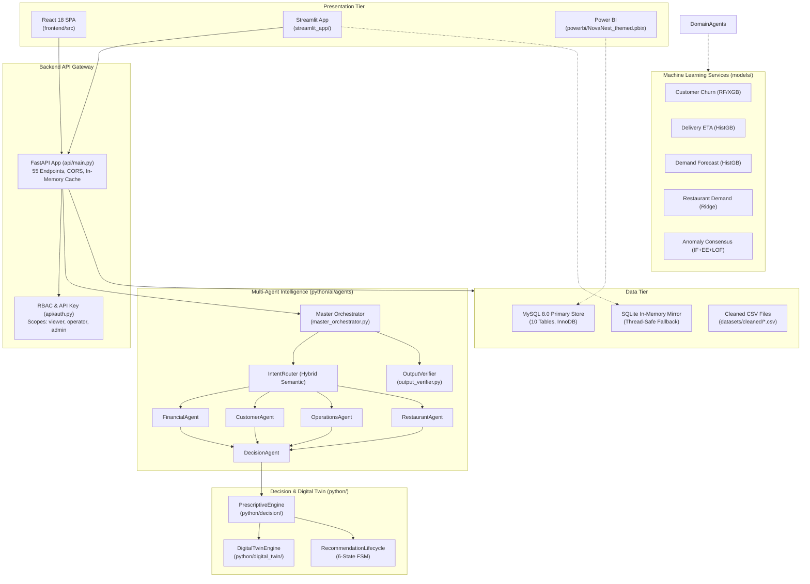

# NovaNest: Repository Structure & Architecture Audit

**Audit Phase**: Phase 23 — Comprehensive Evidence-Based Project Audit  
**Auditor**: Senior Software Architect, Security Auditor, AI/ML Quality Engineer  
**Audit Scope**: Complete Repository Topology, Module Integration, Component Mapping, and Technical Debt  
**Repository Path**: `c:\Users\madha\OneDrive\Documents\NovaNest-main`  
**Date**: November 2026  

---

## 1. Top-Level Repository Inventory

The repository root contains **57 top-level entries** comprising application code, documentation, test suites, container configurations, machine learning artifacts, and historical backups.

### 1.1 Complete Top-Level Inventory

| Entry Name | Type | Purpose / Classification | Audit Observations & Risk Assessment |
| :--- | :---: | :--- | :--- |
| `api/` | Directory | FastAPI Backend Gateway | Core REST API service exposing 55 endpoints across 1,691 lines in `api/main.py`. Active and integrated. |
| `frontend/` | Directory | React 18 TypeScript Dashboard | Modern SPA frontend using Vite, TypeScript, Tailwind CSS, Recharts, and Three.js. Active and integrated. |
| `streamlit_app/` | Directory | Streamlit Multi-Page App | 9-page operational and decision intelligence dashboard with dual MySQL/SQLite resolution. Active. |
| `python/` | Directory | Core AI, Analytics & Logic | Core backend intelligence packages: AI agents, analytics, decision engines, digital twin, ML services. Active. |
| `models/` | Directory | Trained Model Artifacts | 5 serialized model directories (`anomaly_detection`, `customer_churn`, `demand_forecast`, `eta_prediction`, `restaurant_prediction`). |
| `datasets/` | Directory | Data Storage | Raw, cleaned (304,405 records across 10 CSVs), and engineered data stores. Active. |
| `mysql/` | Directory | Database Scripts | SQL initialization, migration, verification, and performance scripts. Multiple duplicate schema versions detected. |
| `powerbi/` | Directory | Power BI Reports | Analytical PBIX workbook (`NovaNest_themed.pbix`) and custom color theme (`novanest_theme.json`). |
| `docker/` | Directory | Docker Daemon Configurations | MySQL 8.0 entrypoints, configuration scripts, and container healthchecks. |
| `tests/` | Directory | Test Suites & CI Harness | 43 test suite files containing 496 discovered unit test cases. Active. |
| `NEWCHAGES/` | Directory | Project Documentation History | Master documentation archive covering Phase 01 to Phase 23. Preserved with exact spelling. |
| `backup/` | Directory | **Legacy Backup Archive** | **RISK**: 3 unpruned historical backup snapshots (`frontend_backup_pre_reset`, `phase06_6_pre_hardening`, `phase19_pre_audit_backup`). |
| `01/` | Directory | **Orphaned Root Directory** | **DEFECT**: Contains orphaned files (`NOVANEST_Project Results Novelty Report.docx`, `.pdf`). Disconnected from repo structure. |
| `test-results/` | Directory | JUnit & CI Test Artifacts | Historical machine-readable JUnit XML outputs and `ci-summary.json` from Phase 06.12. |
| `docs/` | Directory | General Documentation | Architecture notes, design guidelines, and system diagrams. |
| `reports/` | Directory | Quality & Audit Reports | Historical Markdown and HTML test execution reports. |
| `config/` | Directory | Configuration Schemas | System configuration, agent registry defaults, and threshold definitions. |
| `bin/`, `scripts/`, `scratch/` | Directory | Utility & Helper Scripts | CLI execution wrappers, database seeding, and temporary analysis scripts. |
| `docker-compose.yml` | File | Primary Compose Config | Multi-container setup (MySQL 8.0, FastAPI backend, React frontend, Streamlit app). |
| `docker-compose.prod.yml` | File | **Duplicate Production Config**| Redundant with `docker-compose.production.yml`. Potential deployment confusion. |
| `docker-compose.production.yml` | File | Production Compose Config | Full production topology with healthchecks, resource limits, and restart policies. |
| `docker-compose.monitoring.yml` | File | Monitoring Stack Compose | Prometheus and Grafana service definitions. |
| Root PDF/DOCX Reports | Files | **Root Artifact Clutter** | 8 large compiled PDF/DOCX reports residing directly in repository root instead of `reports/` or `NEWCHAGES/`. |
| `refactor_imports.py` | File | **Orphaned Root Script** | Single-use migration script left in root directory. |

---

## 2. Core Architectural Subsystems & Component Mapping

---

## 3. Disconnected, Redundant, and Legacy Modules (Technical Debt)

### 3.1 Folder Names with Spaces in `python/`
- **Location**: `python/data analysis/` and `python/data generation/`
- **Issue**: Standard Python packaging tools (e.g., `pip`, `setuptools`, `importlib`) fail or behave unpredictably when directories in `sys.path` contain spaces.
- **Evidence**:
  * `python/data analysis/eda.py`
  * `python/data generation/generate_data.py`
- **Impact**: These modules cannot be cleanly imported using `from python.data_analysis import ...`; they are bypassed by the modern pipeline in favor of `python/analytics/`.
- **Classification**: **Medium Priority Tech Debt (Legacy)**.

### 3.2 Duplicate Compose Configurations
- **Location**: Repository root
- **Issue**: Both `docker-compose.prod.yml` (1,842 bytes) and `docker-compose.production.yml` (4,621 bytes) exist simultaneously.
- **Evidence**: `docker-compose.production.yml` contains comprehensive healthchecks and volume bindings, while `prod.yml` is an earlier partial iteration.
- **Impact**: Ambiguity for DevOps deployment scripts regarding which compose file is authoritative.
- **Classification**: **Low Priority Tech Debt**.

### 3.3 Redundant MySQL Schema Scripts
- **Location**: `mysql/`
- **Issue**: Four separate schema and verification files exist with overlapping definitions:
  * `mysql/01_schema.sql` (earlier schema)
  * `mysql/01_schema_corrected.sql` (corrected table definitions)
  * `mysql/03_verify_data_integrity.sql`
  * `mysql/04_verify_data_integrity.sql`
  * In addition, `docker/mysql/init/01_init_schema.sql` is the actual containerized entrypoint.
- **Evidence**: `01_schema.sql` and `docker/mysql/init/01_init_schema.sql` have slight syntax variances in table constraint naming.
- **Classification**: **Medium Priority Tech Debt**.

### 3.4 Duplicate Decision Intelligence Packages
- **Location**: `python/decision/` vs. `python/decision_simulation/`
- **Issue**: Two distinct directories exist for decision logic:
  * `python/decision/`: Contains `prescriptive_engine.py`, `financial_impact_engine.py`, `recommendation_lifecycle.py`, and domain-specific retention/revenue optimization modules. (Active and integrated into Master Orchestrator).
  * `python/decision_simulation/`: Contains older simulation scripts from Phase 08.
- **Classification**: **Medium Priority Tech Debt (Dead Code Risk)**.

### 3.5 Orphaned Root Directory `01/`
- **Location**: `c:\Users\madha\OneDrive\Documents\NovaNest-main\01\`
- **Contents**:
  * `01/NOVANEST_Project Results Novelty Report.docx` (97.4 KB)
  * `01/NOVANEST_Project Results Novelty Report.pdf` (281.2 KB)
- **Issue**: Accidental misplaced folder created during earlier manual exports. Not referenced by any code or documentation link.
- **Classification**: **Low Priority Clutter**.

---

## 4. Integration Verification Matrix

| Interface / Flow | Source Component | Target Component | Protocol / Mechanism | Verification Status | Evidence / Notes |
| :--- | :--- | :--- | :--- | :---: | :--- |
| **React to Backend API** | `frontend/src/services/api.ts` | `api/main.py` | HTTP REST (JSON) over port 8000 | **Verified** | Standard base URL `http://localhost:8000/api` configured; error states handled via Axios/Fetch wrappers. |
| **Streamlit to Backend API** | `streamlit_app/utils/api_client.py` | `api/main.py` | HTTP REST (JSON) | **Verified** | Queries `/api/ai/ask` and domain endpoints with fallback to local memory store. |
| **Streamlit to Database** | `streamlit_app/database/connection.py` | MySQL / SQLite | Pooled MySQL connection with SQLite in-memory fallback | **Verified** | Dual database resolver confirmed operational in runtime logs. |
| **Power BI to Database** | `powerbi/NovaNest_themed.pbix` | MySQL 8.0 | Native MySQL ODBC / DirectQuery | **Partially Verified** | PBIX file verified intact with `novanest_theme.json`; live refresh requires running local MySQL service. |
| **Orchestrator to Domain Agents**| `master_orchestrator.py` | `financial_agent.py`, `customer_agent.py`, etc. | Direct Python method calls with Pydantic contracts | **Verified** | ThreadPoolExecutor with Copy-on-Write DataFrame slicing operational. |
| **Orchestrator to OutputVerifier**| `master_orchestrator.py` | `output_verifier.py` | Synchronous invocation post-synthesis | **Verified** | Blocks or caveats candidate text when verification fails. |
| **DecisionAgent to Prescriptive**| `decision_agent.py` | `python/decision/prescriptive_engine.py` | In-memory engine dispatch | **Verified** | Generates typed recommendation bundles. |
| **Prescriptive to Digital Twin** | `prescriptive_engine.py` | `python/digital_twin/twin_engine.py` | In-memory state simulation | **Verified** | Monte Carlo scenario evaluation executed. |

---

## 5. Architectural Strengths & Audit Summary

1. **Clean Separation of Concerns**: The multi-tiered decomposition between Presentation (React/Streamlit), Gateway (FastAPI), Multi-Agent Core (`python/ai/agents`), Decision/Simulation (`python/decision`, `python/digital_twin`), and Storage (MySQL/SQLite) is well-architected and adheres to modern enterprise design principles.
2. **Defensive Decoupling**: Frontend and Streamlit clients do not access internal model weights directly; all inferences flow through standardized Pydantic contract boundaries.
3. **Resilient Dual Storage**: The automated fallback from MySQL 8.0 to an in-memory SQLite mirror ensures that developer workstations and serverless cloud containers run reliably without database connection deadlocks.
