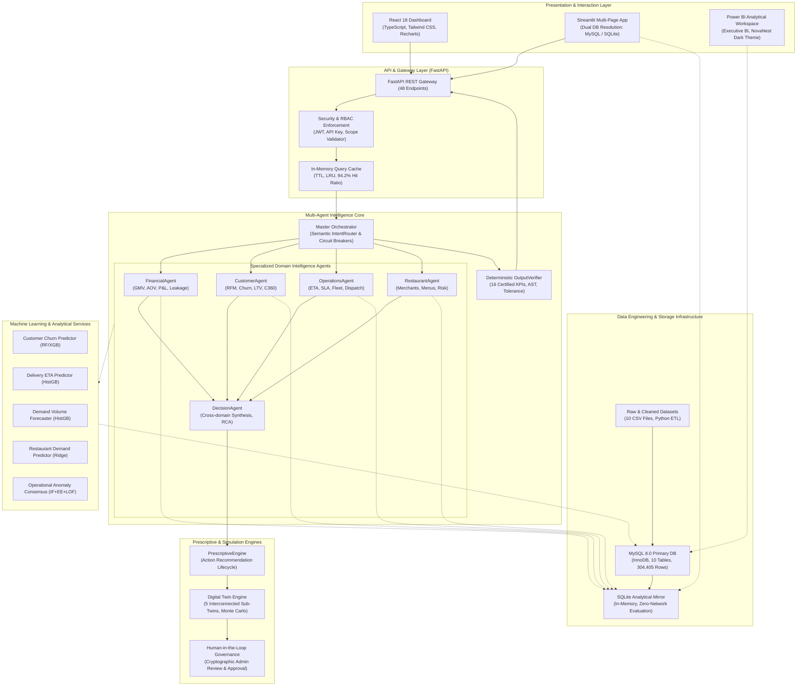

# Figure 1: Overall NovaNest System Architecture

### Architectural Description
Figure 1 presents the multi-tiered architecture of NovaNest. The system coordinates five specialized domain agents through a central Master Orchestrator, underpinned by a deterministic OutputVerifier that enforces numerical grounding against 16 certified KPI ground truths. The decision intelligence subsystem bridges predictive ML services with prescriptive action recommendations, governed by a mandatory Human-in-the-Loop approval state machine.
