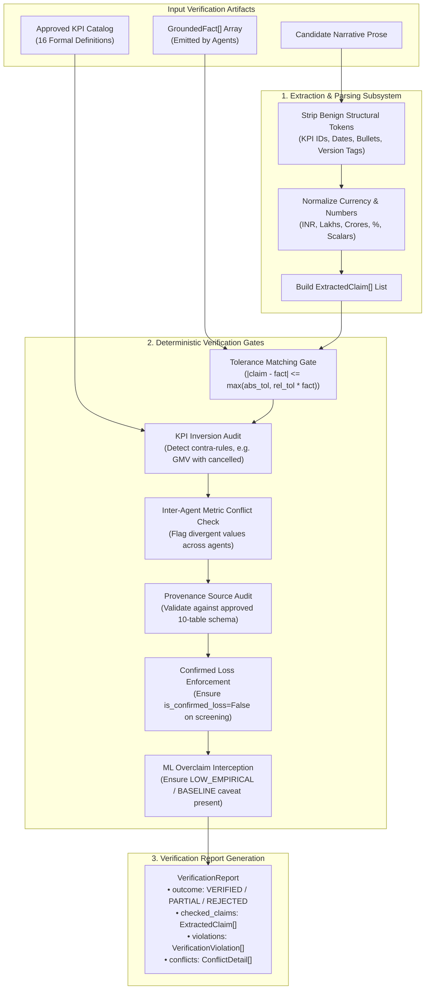
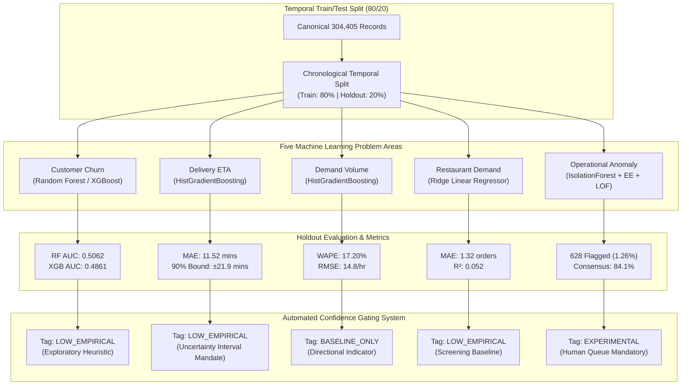
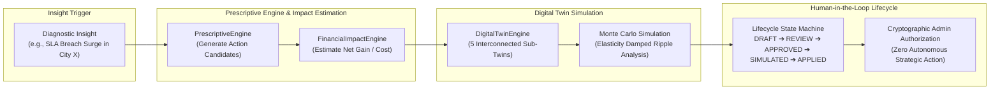
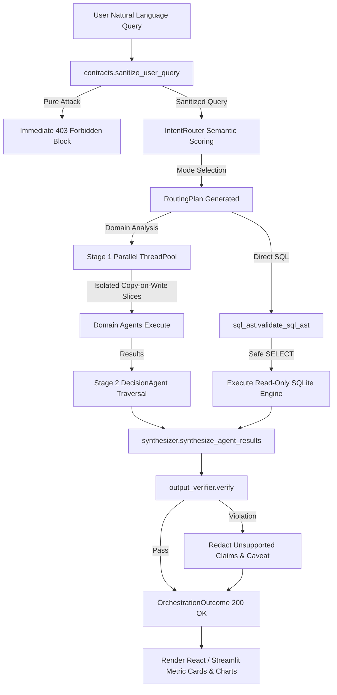
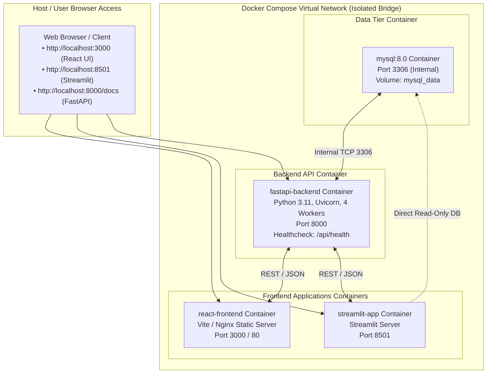

# Figure 6: Deterministic OutputVerifier Architecture & Flow

---

# Figure 7: Machine Learning Training, Validation & Confidence Gating Pipeline

---

# Figure 8: Prescriptive Analytics & Digital Twin Simulation Workflow

---

# Figure 9: Complete User Query Lifecycle

---

# Figure 10: Docker Infrastructure & Deployment Topology

