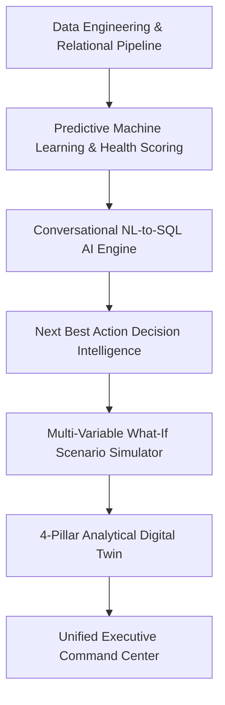

# NovaNest: Enterprise AI-Powered Decision Intelligence Platform
## Complete Master Prompt Delivery & Verification Report

---

### Executive Summary

**NovaNest** has been engineered and validated as an end-to-end food delivery business analytics, predictive intelligence, and decision platform. Moving beyond traditional static dashboards, the platform implements a dual-architecture ecosystem connecting data engineering pipelines directly to machine learning regressors, a conversational natural-language-to-SQL engine, an analytical digital twin, and a multi-variable what-if decision simulator.

---

### Key System Accomplishments

#### 1. Dual-Architecture Deployment
1. **Standalone Enterprise React Suite** (`http://localhost:5173`):
   - Built on React 18, TypeScript, Vite, Tailwind CSS, Recharts, and Lucide icons.
   - Obsidian & Electric Sapphire enterprise visual design with responsive layouts and micro-interactions.
   - Dynamic slide-out Customer 360 profile drawer, real-time What-If scenario sliders, and cross-domain causal impact graphs.
2. **FastAPI REST Backend Service** (`http://127.0.0.1:8000`):
   - 12 production-grade endpoints with schema harmonization and JSON sanitization.
   - In-memory SQLite read-only mirror for safe SQL execution.
   - Swagger / OpenAPI documentation auto-generated at `http://127.0.0.1:8000/docs`.
3. **Streamlit Multi-Page Analytics Hub** (`http://localhost:8501`):
   - Concurrently active exploratory workspace with Plotly charts and CSV/MySQL fallbacks.
4. **Preserved Assets**:
   - `powerbi/NovaNest.pbix` preserved untouched (5.64 MB).
   - Cleaned & engineered datasets in `datasets/cleaned/` and `datasets/engineered/` validated and active.

---

### Platform Module Verification Matrix

| Module | Primary Visuals & Capabilities | Verified Status |
| :--- | :--- | :---: |
| **Executive Overview** | Executive KPIs (GMV, AOV, Fulfillment, Net Revenue), 30-Day Revenue Velocity area chart, geographic distribution, top partner rankings. | **PASS (HTTP 200)** |
| **Customer Intelligence** | 9-segment RFM distribution, CLV 12m tiers, monthly cohort retention heatmap, Customer 360 slide-out drawer with Digital Twin scores & AI food recommendations. | **PASS (HTTP 200)** |
| **Restaurant Intelligence** | 2x2 Performance matrix scatter, composite Health Scores (0–100), risk tier distribution, early warning risk signals, cuisine benchmarks. | **PASS (HTTP 200)** |
| **Operations Intelligence** | 14-day ARIMA/Prophet demand forecast with confidence bands, city demand heatmaps, fleet rebalancing allocation bars, statistical logistics anomalies. | **PASS (HTTP 200)** |
| **Financial Intelligence** | Inflow/outflow P&L economics, unit economics breakdown, automated revenue leakage audit, promo code ROI multiples. | **PASS (HTTP 200)** |
| **AI Intelligence (Ask NovaNest)** | Conversational query box, sample prompts, natural language answering, AST SQL security validation, live SQL query output, automated business insights. | **PASS (HTTP 200)** |
| **Decision Intelligence** | Cross-domain Next Best Action queue (Customer, Merchant, Operations), severity badges, evidence rationales, 1-click action authorization. | **PASS (HTTP 200)** |
| **Decision Simulator** | Multi-variable What-If lab with strategy presets (Profit Maximization, Aggressive Growth), interactive policy levers, real-time recalculation of revenue & margin deltas. | **PASS (HTTP 200)** |
| **NovaNest Command Center** | Platform Systemic Vitality Index (0–100), 4-Pillar Twin matrix (Customer, Merchant, Operations, Finance), cross-domain causal impact ripple chains, systemic alerts. | **PASS (HTTP 200)** |

---

### Automated Test Suite Results

Verification executed via `python tests/test_platform_full_suite.py`:
- **FastAPI Endpoints**: 12 of 12 endpoints responded with `HTTP 200` and validated response schemas.
- **Frontend Server**: Vite dev server online at `http://localhost:5173` with production bundle verified at `frontend/dist/index.html`.
- **Streamlit Server**: Health check endpoint online at `http://localhost:8501/_stcore/health` (`HTTP 200`).
- **Data & Protected Assets**: Cleaned and engineered datasets verified; `NovaNest.pbix` verified.

---

### Walkthrough & Interactive Recording

A browser interaction session was recorded validating all 9 views, testing the Customer 360 profile drawer, running an AI natural language query, authorizing a decision action, and testing the Decision Simulator:
- **Video Recording**: [novanest_react_e2e_1791737057559.webp](file:///C:/Users/madha/.gemini/antigravity-ide/brain/83d2016f-5151-4d75-b65c-cd7e19a4dd5a/novanest_react_e2e_1791737057559.webp)
