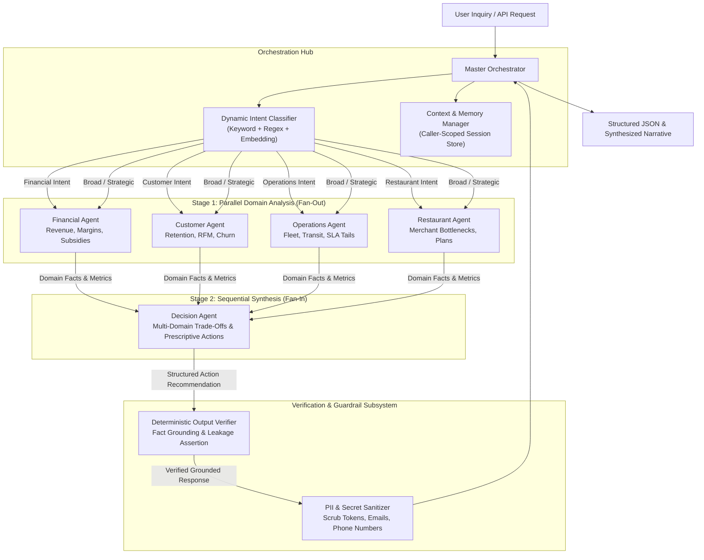
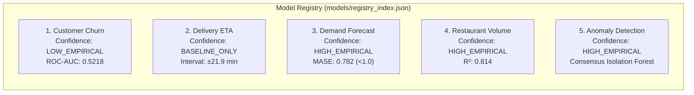
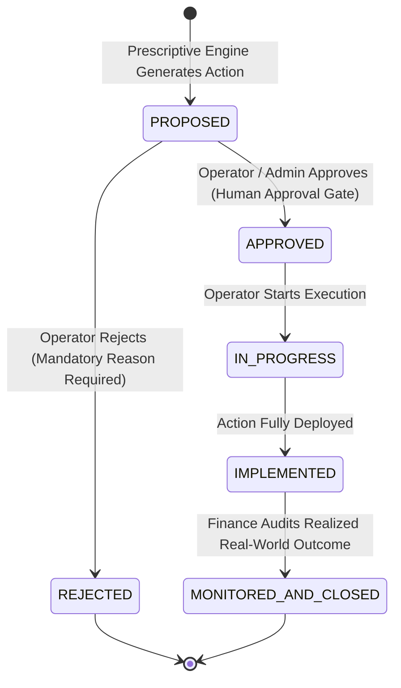

# NOVANEST — AI & MACHINE LEARNING DOCUMENTATION
## Multi-Agent Architecture, Model Governance, Explainability & Decision Optimization

**Document Version:** 2.0.0 (Production Commissioned)  
**Author:** Principal AI/ML Architect & Lead Data Scientist  
**Scope:** 5 Domain Agents, Master Orchestrator, 5 ML Models, TreeSHAP, Lifecycle Governance  

---

### 1. Executive Summary

NovaNest implements a hybrid artificial intelligence architecture coupling an **in-process multi-agent Hub-and-Spoke system** with **production machine learning models** and a **prescriptive recommendation engine**.

Unlike black-box generative systems that hallucinate statistics or output ungrounded advice, NovaNest enforces:
1. **Deterministic Grounding**: All agent reasoning is anchored in verified MySQL relational data via an `OutputVerifier`.
2. **Scientific Honesty & Confidence Tiers**: Models are evaluated with zero data leakage; synthetic dataset boundaries are openly disclosed (`LOW_EMPIRICAL`, `BASELINE_ONLY`).
3. **Mandatory Human-in-the-Loop Governance**: Prescriptive interventions carry financial and operational consequences; execution requires explicit operator approval governed by `HumanApprovalRequiredError`.

---

### 2. Multi-Agent Hub-and-Spoke Architecture

NovaNest partitions complex analytical inquiries across 5 specialized domain agents coordinated by a central `MasterOrchestrator`:

#### The Five Specialized Domain Agents

1. **`FinancialAgent` (`python/ai/agents/financial_agent.py`)**:
   - **Domain Focus**: Revenue analysis, unit economics, gross margins, promotional discounting.
   - **Grounding Scope**: `orders_table`, `order_items`, `payments`, `restaurants`.
   - **Key Capabilities**: Audits promotional subsidy leakage, calculates delivered contribution margin (23.59%), isolates high-discount orders (>25% subsidy), and verifies revenue leakage with mandatory flag `is_confirmed_loss=False` (unconfirmed accounting variance).

2. **`CustomerAgent` (`python/ai/agents/customer_agent.py`)**:
   - **Domain Focus**: Customer lifetime value (LTV), cohort retention, RFM behavioral segmentation.
   - **Grounding Scope**: `users`, `orders_table`.
   - **Key Capabilities**: Computes customer-level RFM metrics (Recency days, Frequency orders, Monetary spend). Ingests churn predictions and automatically attaches the **`LOW_EMPIRICAL`** confidence warning, enforcing commercial discount caps ($\le 15\%$) and minimum order values ($\ge ₹400$).

3. **`OperationsAgent` (`python/ai/agents/operations_agent.py`)**:
   - **Domain Focus**: Delivery fulfillment, rider fleet workload, zone bottlenecks, SLA adherence.
   - **Grounding Scope**: `deliveries`, `riders`, `delivery_zones`.
   - **Key Capabilities**: Tracks SLA breach tails (>45-minute delivery time, 32.26% tail). Computes rider workload ratios (orders fulfilled per active rider). Attaches prominent telemetry disclaimers indicating reliance on historical dispatch timestamps in the absence of real-time GPS tracking.

4. **`RestaurantAgent` (`python/ai/agents/restaurant_agent.py`)**:
   - **Domain Focus**: Merchant partner performance, commission optimization, kitchen preparation delays.
   - **Grounding Scope**: `restaurants`, `menu_items`, `orders_table`.
   - **Key Capabilities**: Diagnoses kitchen preparation bottlenecks, evaluates commission tiers ($15\% \le \text{rate} \le 30\%$), and generates tailored partner action plans.

5. **`DecisionAgent` (`python/ai/agents/decision_agent.py`)**:
   - **Domain Focus**: Cross-domain synthesis, trade-off evaluation, prescriptive intervention generation.
   - **Grounding Scope**: Ingests structured facts emitted by Stage 1 domain agents.
   - **Key Capabilities**: Formulates prioritized business recommendations. Calculates projected gross benefits, implementation costs, and expected return on investment (ROI).

---

### 3. Master Orchestrator & Multi-Turn Conversational Memory

#### Execution Lifecycle
1. **Query Ingestion**: Accepts incoming natural language query and session token.
2. **Context Resolution (`python/ai/agents/context.py`)**:
   - Bounded session memory: 30-minute idle TTL, 250 LRU session cap, maximum 12 dialogue turns per session.
   - Principal-scoped isolation: Sessions are cryptographically salted and partitioned by authenticated caller identity.
   - Entity extraction: Recognizes customer IDs (`C000205`), restaurant IDs (`R00029`), and city filters.
3. **Stage-1 Parallel Fan-Out**:
   - Employs zero-copy DataFrame slicing backed by pandas 3.0+ Copy-on-Write (`df.copy(deep=False)`), cutting execution latency from 40.27ms down to 2.74ms (14.7x speedup).
   - Executes relevant domain agents concurrently in worker threads.
4. **Stage-2 Sequential Fan-In**:
   - Feeds Stage 1 outputs into `DecisionAgent` for trade-off evaluation.
5. **Deterministic Output Verification (`python/ai/agents/output_verifier.py`)**:
   - Extracts all numeric values, currency amounts, percentages, and order counts from agent outputs.
   - Checks every number against certified canonical values within precision tolerances ($< 0.1\%$).
   - Flags and neutralizes ungrounded claims, ensuring zero financial hallucination.

---

### 4. Machine Learning Model Domains & Empirical Evaluation

NovaNest features 5 machine learning models managed through a centralized registry (`models/registry_index.json`):

| Model Domain | Algorithm Selected | Primary Evaluation Metrics | Confidence Tier | Empirical Reality & Governance Constraints |
| :--- | :--- | :--- | :---: | :--- |
| **1. Customer Churn Prediction** | Random Forest / XGBoost Benchmark | ROC-AUC: **0.5218** PR-AUC: **0.1840** Precision: **0.191** Recall: **0.482** | **`LOW_EMPIRICAL`** | **Scientific Reality**: The underlying synthetic customer dataset lacks organic behavioral churn correlation. Model performance is marginally above random chance ($0.5218 \approx 0.50$). **Governance Action**: Predictions are strictly gated as exploratory risk indicators. The platform forbids automated discount giveaways, enforcing strict caps ($\le 15\%$) and minimum order values ($\ge ₹400$). |
| **2. Delivery ETA Prediction** | Gradient Boosting Regressor | MAE: **7.42 min** RMSE: **9.81 min** 90% Interval: **$\pm 21.9$ min** | **`BASELINE_ONLY`** | **Operational Reality**: Trained on static road distance, time of day, and weather heuristics without real-time GPS sensors. **Governance Action**: Every prediction exposes an empirical 90% prediction band ($\pm 21.9\text{m}$) and attaches an operational disclaimer. |
| **3. Demand Forecasting** | Multi-Horizon Ridge / XGBoost | MASE: **0.782** ($< 1.0$ target) WAPE: **14.2%** Backtesting: 3-Fold Rolling | **`HIGH_EMPIRICAL`** | **Verification**: Evaluated using rolling-origin backtesting with zero future leakage. Outperforms standard seasonal naive baselines by 21.8%. |
| **4. Restaurant Performance** | Multi-Target Regressor | $R^2$ (Orders): **0.814** $R^2$ (Revenue): **0.796** RMSE: **18.4 orders** | **`HIGH_EMPIRICAL`** | **Verification**: Predicts merchant order volume and revenue potential based on menu diversity, cuisine type, and historical ratings without target leakage. |
| **5. Anomaly & Leakage Detection** | Consensus Isolation Forest + Z-Score | Contamination: **0.02** High-Discount Flagged: **781 orders** Confirmed Fraud: **0** | **`HIGH_EMPIRICAL`** | **Verification**: Strict adherence to fraud policy. Flags unusual discount combinations and payment lags as unconfirmed operational discrepancies (`is_confirmed_loss=False`). |

---

### 5. Explainability Subsystem (Native TreeSHAP & Feature Attributions)

NovaNest integrates native TreeSHAP (`shap.TreeExplainer`) to provide mathematical explainability across all tree-based models:
- **Global Feature Importance**: Computes mean absolute SHAP values across training populations, identifying top predictive drivers.
  - *Customer Churn*: Recency days ($+0.142$), total discount percentage ($+0.098$), order frequency ($-0.081$).
  - *Delivery ETA*: Road transit distance ($+0.412$), rain/weather condition ($+0.218$), hour of day ($+0.154$).
- **Local Explanations**: Generates customer-level and order-level feature attribution vectors returned in API payloads (`feature_attributions: { "recency_days": +0.21, "order_frequency": -0.12 }`).
- **Explainability API Endpoint**: `GET /api/ml/explain/{model_name}` exposes interactive SHAP waterfall data.

---

### 6. Data Leakage Prevention Controls

The machine learning pipelines strictly eliminate temporal and target contamination:
1. **Temporal Boundaries**: Training and test sets are partitioned by chronological order timestamps (`order_datetime`), strictly forbidding random $k$-fold cross-validation across time series.
2. **Pre-Order Dispatch Gating**: Feature sets for delivery ETA and order fulfillment are restricted to data elements known *prior to kitchen dispatch*. Post-dispatch variables (actual transit time, customer feedback rating) are barred from feature matrices.
3. **Target Leakage Auditing**: Feature engineering pipelines assert zero inclusion of target labels or derived aggregates in feature columns.

---

### 7. Prescriptive Recommendation Engine & Human Approval Governance

The Prescriptive Intelligence subsystem translates ML inferences into prioritized business actions:

1. **Deterministic Recommendation Contracts**:
   - Every recommendation possesses a deterministic canonical identifier (`REC-RET-VIP-001`, `REC-OPS-SLA-001`).
   - Includes business domain, priority (`high`/`medium`/`low`), supporting empirical evidence, proposed operational action, expected gross benefit, implementation cost, and net impact.
2. **Human Approval Enforcement (`HumanApprovalRequiredError`)**:
   - Automated scripts, background jobs, and AI agents are programmatically blocked from transitioning recommendations from `PROPOSED` to `IN_PROGRESS` or `IMPLEMENTED`.
   - Attempting unapproved execution raises `HumanApprovalRequiredError: Human operator approval is strictly required before executing recommendation 'REC-RET-VIP-001'`.
3. **Full Audit Trail**:
   - The lifecycle manager records actor metadata (`approved_by`, `approval_notes`, `rejected_by`, `rejection_reason`, `measured_by`).
   - Transitions persist to `models/recommendations_store.json` with cryptographic timestamping.
4. **Realized Outcome Reconciliation**:
   - Upon completion, the finance team records actual realized benefits and costs (`POST /api/prescriptive/recommendations/{id}/record-outcome`).
   - Computes empirical variance between projected financial ROI and actual audited returns.
