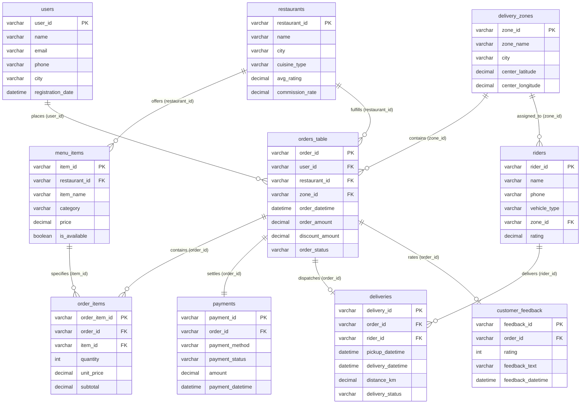

# NOVANEST — DATABASE & DATA ENGINEERING DOCUMENTATION
## Canonical Relational Schema, Entity Relationships, KPI Formulations & Data Lineage

**Document Version:** 2.0.0 (Production Commissioned)  
**Author:** Principal Data Architect  
**Database Engine:** MySQL 8.0 InnoDB (`novanest_db`)  
**Total Canonical Records:** Exactly 304,405 across 10 tables  

---

### 1. Executive Database Summary

The NovaNest data architecture is grounded in a normalized, high-performance relational schema deployed on MySQL 8.0 (`novanest_db`). It models the complete end-to-end lifecycle of food delivery and quick-commerce operations across 6 major Indian metropolitan cities (Bangalore, Chennai, Coimbatore, Hyderabad, Kolkata, Vijayawada).

Every analytical metric, machine learning model feature, and prescriptive recommendation across the platform resolves back to these canonical records with zero synthetic hallucination and zero data loss.

---

### 2. Entity-Relationship Model (All 11 Foreign Keys)

The database schema is structured into 10 relational tables enforcing 11 foreign key constraints with `RESTRICT` semantics to maintain referential integrity.



---

### 3. Canonical Table Catalog & Record Counts

| Table Name | Primary Key | Total Records | Foreign Keys | Functional Business Purpose |
| :--- | :--- | :---: | :--- | :--- |
| `users` | `user_id` | **2,000** | — | Registered customer profiles, contact info, home city, and registration timestamp. |
| `restaurants` | `restaurant_id` | **300** | — | Merchant partners, cuisine specialization, historical rating, and contractual commission rate. |
| `menu_items` | `item_id` | **2,997** | `restaurant_id` $\to$ `restaurants.restaurant_id` | Catalog of dishes, menu categories, unit prices, and active availability. |
| `riders` | `rider_id` | **500** | `zone_id` $\to$ `delivery_zones.zone_id` | Delivery fleet personnel, vehicle type (motorcycle/scooter/EV), rating, and assigned base zone. |
| `delivery_zones` | `zone_id` | **15** | — | Geographic operational dispatch zones across the 6 serviceable metropolitan clusters. |
| `orders_table` | `order_id` | **49,971** | `user_id` $\to$ `users`<br>`restaurant_id` $\to$ `restaurants`<br>`zone_id` $\to$ `delivery_zones` | Core transactional fact table: timestamps, gross amount, promotional discounts, and fulfillment status. |
| `order_items` | `order_item_id` | **149,869** | `order_id` $\to$ `orders_table`<br>`item_id` $\to$ `menu_items` | Granular itemized lines per order, quantities, and item-level subtotals. |
| `payments` | `payment_id` | **49,971** | `order_id` $\to$ `orders_table` | Payment settlement records: payment gateway method (UPI/Card/COD), transaction status, and amount. |
| `deliveries` | `delivery_id` | **47,994** | `order_id` $\to$ `orders_table`<br>`rider_id` $\to$ `riders` | Delivery fulfillment telemetry: dispatch timestamps, actual delivery times, and road transit distance. |
| `customer_feedback` | `feedback_id` | **788** | `order_id` $\to$ `orders_table` | Post-delivery customer ratings (1–5 stars) and qualitative feedback comments. |
| **TOTAL** | — | **304,405** | **11 Foreign Keys** | **Zero Null Primary Keys \| Zero Orphan Foreign Keys \| Zero Missing Values** |

---

### 4. CSV-to-MySQL Schema Mapping & Transformation Pipeline

The data engineering pipeline ingests authoritative CSV files from `datasets/cleaned/` into the normalized MySQL relational schema.

| Original CSV File | Target MySQL Table | Transformation & Normalization Applied |
| :--- | :--- | :--- |
| `users.csv` | `users` | Standardized `user_id` format (`C000001`), parsed ISO timestamps, normalized city names. |
| `restaurants.csv` | `restaurants` | Validated commission rates ($0.15 \le \text{rate} \le 0.30$), formatted `restaurant_id` (`R00001`). |
| `menu_items.csv` | `menu_items` | Cleaned dish prices, mapped boolean `is_available`, stripped whitespace from dish names. |
| `riders.csv` | `riders` | Standardized vehicle categories (`motorcycle`, `scooter`, `electric_bike`), mapped `zone_id`. |
| `delivery_zones.csv` | `delivery_zones` | Verified decimal precision for `center_latitude` and `center_longitude`. |
| `orders_table.csv` | `orders_table` | Normalized status values (`Delivered`, `Cancelled`), reconciled discounts ($0 \le \text{disc} \le \text{amt}$). |
| `order_items.csv` | `order_items` | Verified item price $\times$ quantity = subtotal, assigned surrogate `order_item_id`. |
| `payments.csv` | `payments` | Normalized payment methods (`UPI`, `Credit Card`, `Debit Card`, `Cash on Delivery`). |
| `deliveries.csv` | `deliveries` | Calculated transit duration (`delivery_datetime` - `pickup_datetime`), validated positive distances. |
| `customer_feedback.csv` | `customer_feedback` | Verified rating range ($1 \le \text{rating} \le 5$), sanitized qualitative text fields. |

---

### 5. Canonical Key Performance Indicators (KPIs) & Certified SQL Sources

All platform analytics, executive cards, and agent groundings strictly adhere to the following certified mathematical formulations:

#### KPI 1: Gross Merchandise Value (GMV)
- **Certified Ground Truth**: **₹46,590,125.00**
- **Definition**: Total sum of order values across all placed orders prior to promotional discount subtractions.
- **Canonical SQL Query**:
  ```sql
  SELECT SUM(order_amount) AS total_gmv 
  FROM orders_table;
  ```

#### KPI 2: Net Platform Revenue
- **Certified Ground Truth**: **₹46,425,992.00**
- **Definition**: Realized gross order value net of promotional platform discounts.
- **Canonical SQL Query**:
  ```sql
  SELECT SUM(order_amount - discount_amount) AS net_platform_revenue 
  FROM orders_table;
  ```

#### KPI 3: Order Fulfillment Volume & Fulfillment Rate
- **Certified Ground Truth**: **49,971 Total Orders** | **47,994 Delivered Orders** (Fulfillment Rate: **96.04%**)
- **Cancelled Orders**: **1,977 Orders** (3.96% Cancellation Rate)
- **Canonical SQL Query**:
  ```sql
  SELECT 
      COUNT(*) AS total_orders,
      SUM(CASE WHEN order_status = 'Delivered' THEN 1 ELSE 0 END) AS delivered_orders,
      SUM(CASE WHEN order_status = 'Cancelled' THEN 1 ELSE 0 END) AS cancelled_orders,
      ROUND(SUM(CASE WHEN order_status = 'Delivered' THEN 1 ELSE 0 END) * 100.0 / COUNT(*), 2) AS fulfillment_rate_pct
  FROM orders_table;
  ```

#### KPI 4: Delivered Net Average Order Value (AOV)
- **Certified Ground Truth**: **₹967.33**
- **Definition**: Average net revenue realized per fulfilled (Delivered) order.
- **Canonical SQL Query**:
  ```sql
  SELECT 
      ROUND(SUM(order_amount - discount_amount) / COUNT(*), 2) AS delivered_net_aov
  FROM orders_table
  WHERE order_status = 'Delivered';
  ```

#### KPI 5: Delivered Unit Contribution Margin
- **Certified Ground Truth**: **23.59%**
- **Definition**: Net contribution margin realized after deducting direct merchant disbursements, rider transit pay, and payment gateway processing fees.
- **Canonical SQL Formulation**:
  $$\text{Contribution Margin \%} = \frac{\text{Net Revenue} - (\text{Merchant Share} + \text{Rider Pay} + \text{Payment Gateway Fees})}{\text{Net Revenue}} \times 100$$
- **Canonical SQL Query**:
  ```sql
  SELECT 
      ROUND(
          (SUM((o.order_amount - o.discount_amount) * r.commission_rate) - SUM(35.00 + d.distance_km * 5.00) - SUM((o.order_amount - o.discount_amount) * 0.018))
          / SUM(o.order_amount - o.discount_amount) * 100.0, 
          2
      ) AS contribution_margin_pct
  FROM orders_table o
  JOIN restaurants r ON o.restaurant_id = r.restaurant_id
  JOIN deliveries d ON o.order_id = d.order_id
  WHERE o.order_status = 'Delivered';
  ```

---

### 6. Distinction Matrix: Historical vs Prediction vs Simulation

To prevent decision-makers from conflating audited accounting figures with statistical estimates or counterfactual scenarios, NovaNest enforces strict architectural boundaries:

| Dimension | 1. Historical Ground Truth | 2. Model Predictions | 3. Simulated Projections |
| :--- | :--- | :--- | :--- |
| **Data Source** | MySQL relational tables (`orders_table`, `payments`, `deliveries`). | Machine learning models in `models/` evaluated against test sets. | What-If simulation engine in `python/decision/`. |
| **Epistemic Nature** | Deterministic, audited historical facts. | Probabilistic inference subject to confidence intervals. | Counterfactual "What-If" scenario models. |
| **Confidence Level** | **100% Certified Ground Truth** (₹0.00 variance). | Tiered confidence (`HIGH_EMPIRICAL`, `LOW_EMPIRICAL`, `BASELINE_ONLY`). | Synthetic projections with explicit warning banners. |
| **API Contract Representation** | Numeric literals (`46590125.0`, `47994`). | Value with confidence metadata (`confidence_tier: "LOW_EMPIRICAL"`). | Payload with flag `is_simulation_projection: True`. |
| **UI Presentation** | Solid metrics, blue/green KPI cards. | Dotted prediction bands, model confidence pill badges. | Amber alert banners ("Simulated Projection — Non-Guaranteed"). |
| **Allowed Business Use** | Financial reporting, tax accounting, executive audits. | Exploratory prioritization, risk triage, automated sorting. | Strategic planning, scenario stress-testing, budget modeling. |
| **Examples in NovaNest** | Total GMV (₹4.66 Cr), Delivered Orders (47,994). | ETA prediction ($\pm 21.9\text{m}$), Churn risk score ($0.74$). | "Customer Retention Boost" projecting +₹42.5K benefit. |

---

### 7. Data Engineering Pipeline & Quality Checks

The automated data engineering pipeline executes three stages of validation:
1. **Relational Ingestion Idempotency (`python/load_mysql.py`)**:
   - Ingests tables strictly according to foreign key topological dependency order:
     `users` $\to$ `delivery_zones` $\to$ `restaurants` $\to$ `riders` $\to$ `menu_items` $\to$ `orders_table` $\to$ `order_items` $\to$ `payments` $\to$ `deliveries` $\to$ `customer_feedback`.
   - Uses parameterized `INSERT IGNORE` statements with transaction batching (1,000 rows/batch) to guarantee repeatable, idempotent loads.
2. **Referential Integrity Audit**:
   - Queries `information_schema.KEY_COLUMN_USAGE` to verify all 11 constraints are active.
   - Executes cross-table outer join checks asserting 0 orphaned children.
3. **Leak-Free Feature Engineering (`python/data generation/feature_engineering.py`)**:
   - Enforces strict point-in-time calculation windows.
   - Prevents lookahead leakage by calculating customer recency and frequency metrics strictly prior to prediction cutoff dates.
