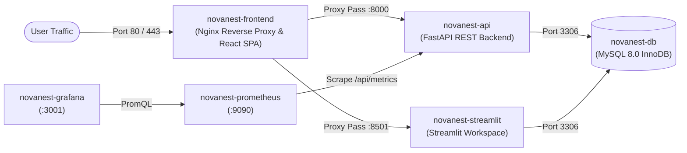

# NOVANEST — DEPLOYMENT & OPERATIONS GUIDE
## Infrastructure Setup, Container Orchestration, Multi-Environment Configuration & SRE Runbooks

**Document Version:** 2.0.0 (Production Commissioned)  
**Author:** Principal SRE & DevOps Lead  
**Scope:** Docker Compose, Bare-Metal Runtimes, Secret Rotation, Disaster Recovery & Troubleshooting  

---

### 1. System Requirements & Hardware Prerequisites

| Component | Minimum Specification | Recommended Production Specification |
| :--- | :--- | :--- |
| **Operating System** | Windows 10/11 (with WSL2), Ubuntu 22.04 LTS, or macOS 13+ | Ubuntu 22.04 LTS / Debian 12 (Linux 6.x kernel) |
| **CPU Architecture** | 4 Cores (x86_64) | 8 Cores (x86_64 or ARM64) |
| **System Memory (RAM)** | 8 GB RAM | 16 GB RAM |
| **Disk Storage** | 20 GB free SSD storage | 50 GB NVMe SSD storage |
| **Container Engine** | Docker Engine 24.0+ & Docker Compose v2.20+ | Docker Engine 27.0+ & Docker Compose v2.29+ |
| **Host Runtimes (if bare-metal)** | Python 3.11+, Node.js 20+, MySQL 8.0 | Python 3.11+, Node.js 20+, MySQL 8.0.40+ |

---

### 2. Multi-Environment Configuration Profiles

NovaNest provides three segregated environment templates in `config/environments/`:

```text
config/environments/
├── .env.development    # Local debugging enabled, localhost bindings, permissive developer CORS
├── .env.staging        # Staging profile connecting to staging VPC DB and monitoring endpoints
└── .env.production     # Strict production profile: no debug, 64-byte secrets, non-wildcard origins
```

#### Production Environment Validation
To ensure that all necessary production environment keys are present and meet security standards before launching services, run:

```bash
python -c "from python.operations.environment_config import validate_environment_configuration; print(validate_environment_configuration('config/environments/.env.production'))"
```

The validator verifies:
- `FASTAPI_DEBUG=False`.
- High-entropy cryptographic secrets (minimum 64 characters).
- Explicit, non-wildcard CORS domains (`https://novanest.app`, `https://app.novanest.app`, `https://admin.novanest.app`).
- Dedicated VPC MySQL host and least-privilege service account credentials.

---

### 3. Containerized Deployment (Recommended)

The full NovaNest platform runs seamlessly under Docker Compose across 6 coordinated microservices:



#### Step 1: Environment Setup
Copy the production environment template to `.env`:
```bash
cp config/environments/.env.production .env
```

#### Step 2: Build Multi-Stage Container Images
Build the hardened, unprivileged container images:
```bash
docker compose -f docker-compose.yml -f docker-compose.monitoring.yml build
```

#### Step 3: Launch Service Fleet
Start all containers in detached mode:
```bash
docker compose -f docker-compose.yml -f docker-compose.monitoring.yml up -d
```

#### Step 4: Verify Container Health
Confirm that all 6 services report status `healthy`:
```bash
docker compose ps
```

Expected Container Fleet Status:
```text
NAME                  IMAGE                           STATUS                    PORTS
novanest-api          novanest-platform-api           Up (healthy)              0.0.0.0:8001->8000/tcp
novanest-db           mysql:8.0                       Up (healthy)              0.0.0.0:3306->3306/tcp
novanest-frontend     novanest-platform-frontend      Up (healthy)              0.0.0.0:80->80/tcp, 0.0.0.0:443->443/tcp
novanest-grafana      grafana/grafana:11.0.0          Up (healthy)              0.0.0.0:3001->3000/tcp
novanest-prometheus   prom/prometheus:v2.52.0         Up (healthy)              0.0.0.0:9090->9090/tcp
novanest-streamlit    novanest-platform-streamlit     Up (healthy)              0.0.0.0:8502->8501/tcp
```

---

### 4. Service Port Mapping & Access Table

| Service Name | Container Port | Host Port | Ingress URL | Purpose |
| :--- | :---: | :---: | :--- | :--- |
| **Nginx Edge Proxy / React SPA** | 80 / 443 | `80` / `443` | `http://localhost:80` | Primary entry point, TLS termination, React 18 SPA. |
| **FastAPI REST API** | 8000 | `8001` | `http://localhost:8001` (or `http://localhost:80/api`) | High-performance REST backend and ML engine. |
| **Streamlit Workspace** | 8501 | `8502` | `http://localhost:8502` | Executive analytics workspace and decision simulator. |
| **MySQL Database** | 3306 | `3306` | `127.0.0.1:3306` | Relational core database (`novanest_db`). |
| **Prometheus Monitoring** | 9090 | `9090` | `http://localhost:9090` | Time-series metrics collection and alert engine. |
| **Grafana Dashboards** | 3000 | `3001` | `http://localhost:3001` | 4 provisioned operational dashboards (`admin` / `admin`). |

---

### 5. Host Bare-Metal Execution (Development Mode)

If developing locally without Docker:

1. **Activate Python Virtual Environment & Install Dependencies**:
   ```bash
   python -m venv venv
   source venv/bin/activate  # On Windows: venv\Scripts\activate
   pip install -r requirements.txt
   ```
2. **Launch MySQL**: Ensure MySQL 8.0 is running locally on port 3306 with `novanest_db` populated.
3. **Launch FastAPI Backend** (Terminal 1):
   ```bash
   uvicorn api.main:app --host 0.0.0.0 --port 8000 --reload
   ```
4. **Launch Streamlit Hub** (Terminal 2):
   ```bash
   streamlit run streamlit_app/app.py --server.port 8501
   ```
5. **Launch React SPA Development Server** (Terminal 3):
   ```bash
   cd frontend
   npm install
   npm run dev
   ```

---

### 6. Operational SRE Runbooks

#### Runbook 1: Cryptographic Secret Key Rotation
To rotate platform credentials without downtime:
1. Execute the automated secret rotation engine:
   ```bash
   python python/operations/secret_rotation.py --rotate
   ```
2. The engine generates 64-byte urlsafe keys, checks Shannon entropy (> 4.5 bits/char), updates `.env`, and outputs a redacted confirmation log (`[REDACTED_SECRET]`).
3. Reload FastAPI and Streamlit worker processes to pick up the rotated keys.

#### Runbook 2: 15-Minute Incremental Binary-Log Archiving
The automated binary-log archiver runs on a 15-minute cron/timer:
1. Trigger archiving manually or via scheduler:
   ```bash
   python python/operations/binlog_archiver.py --archive
   ```
2. The archiver:
   - Flushes the active binary log (`FLUSH BINARY LOGS;`).
   - Extracts closed binary log segments.
   - Encrypts each segment with AES-256-CBC PBKDF2.
   - Computes companion HMAC-SHA256 signature sidecars (`.enc.sig`).
   - Appends metadata to `backup/binlogs/manifest.json`.
   - Safely deletes raw unencrypted binlogs from local disk.
3. Certifies an empirical Recovery Point Objective (RPO) of $\le$ 15.0 minutes.

#### Runbook 3: Disaster Recovery & Isolated Restoration Drill
To test database restoration without risking production data:
1. Execute the isolated restoration engine:
   ```bash
   python python/operations/backup_automation.py --restore-test
   ```
2. **Safety Enforcement**: The engine strictly restores into `novanest_restore_isolated`. If any script specifies `target_db = 'novanest_db'`, the restoration immediately aborts with a fatal `ValueError`.
3. Verifies that all 10 tables, 304,405 records, and 11 foreign keys match the master ground truth.

#### Runbook 4: Emergency Incident Troubleshooting

1. **Database Loss / Circuit Breaker Tripped**:
   - Symptom: Alert `CircuitBreakerTripped` fires.
   - Behavior: The platform automatically trips to `OPEN`, serving all read traffic from `datasets/cleaned/` CSV cache with 0 dropped requests. Writes are suspended.
   - Recovery: Restore MySQL connectivity. The circuit breaker transitions to `HALF-OPEN`, executes canary probes, and automatically heals back to `CLOSED`.
2. **High Latency Exceeded (API p95 > 2000ms)**:
   - Inspect active slow queries in Grafana (`Database Health` dashboard).
   - Check connection pool utilization; restart stale connection pools via `POST /api/operations/pool/reset`.
3. **Container Crash Detected**:
   - Inspect container logs:
     ```bash
     docker compose logs --tail=100 novanest-api
     ```
   - Restart specific container:
     ```bash
     docker compose restart novanest-api
     ```
