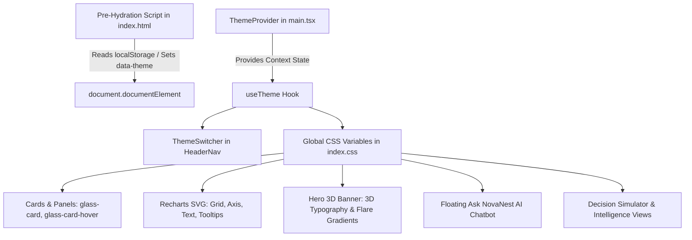

# NovaNest — Complete Multi-Theme System Implementation Report

**Project:** NovaNest — AI-Powered Food Delivery Business Analytics, Intelligence and Decision Platform  
**Feature:** Enterprise Multi-Theme System & Theme Switcher  
**Environment:** Localhost (`http://127.0.0.1:8000` REST API, `http://localhost:5173` React Frontend)  
**Date:** 2026-10-12  

---

## Executive Summary

A complete, centralized **Multi-Theme System** has been successfully integrated into the NovaNest enterprise analytics platform without rebuilding the application, compromising backend logic, or altering established layouts and interactions.

Users can seamlessly toggle between **six distinct visual themes** using an interactive, accessible Theme Switcher located in the top navigation bar. Every theme modifies surfaces, cards, borders, typography, status badges, chart colors, modals, and the floating Ask NovaNest AI chatbot with accessible contrast and smooth CSS transitions. The active theme persists across browser reloads via `localStorage`, and an inline pre-hydration script prevents any flash of an incorrect theme during initial load.

---

## 1. Six Selectable Themes

| Theme ID | Display Name | Visual Character & Ambiance | Palette Swatches | Dark/Light |
| :--- | :--- | :--- | :--- | :---: |
| `midnight` | **Midnight Dark** (Default) | Original deep obsidian cockpit with vibrant sapphire accents and high-contrast telemetry. | `#06090E`, `#3B82F6`, `#06B6D4` | Dark |
| `light` | **Light Mode** | Crisp, clean executive white and slate-900 interface with subtle borders and soft depth shadows. | `#FFFFFF`, `#2563EB`, `#F1F5F9` | Light |
| `cyberpunk` | **Cyberpunk** | High-energy futuristic aesthetic with electric neon cyan, vivid purple matrices, and hot pink highlights. | `#060512`, `#00F0FF`, `#A855F7` | Dark |
| `glassmorphism` | **Glassmorphism** | Translucent acrylic frosted panels with ambient radial illumination, 20px blur, and specular borders. | `#080E1A`, `#38BDF8`, `rgba(255,255,255,0.2)` | Dark |
| `ocean` | **Ocean Blue** | Deep maritime navy aesthetic with vivid sky blue, marine cyan radiance, and tranquil data lines. | `#030C19`, `#0EA5E9`, `#06B6D4` | Dark |
| `emerald` | **Emerald Green** | Botanical obsidian theme with radiant emerald vitals, mint highlights, and forest jade borders. | `#030F0A`, `#10B981`, `#34D399` | Dark |

---

## 2. Architecture & Design System

The multi-theme system is built upon a clean, decoupled design tokens architecture:



### Key Technical Mechanisms

1. **Pre-Hydration Anti-Flash Script (`frontend/index.html`)**:
   - Executes synchronously before React mounting:
   ```html
   <script>
     (function() {
       try {
         var saved = localStorage.getItem('novanest_theme') || 'midnight';
         document.documentElement.setAttribute('data-theme', saved);
         if (saved === 'light') {
           document.documentElement.classList.add('theme-light');
         }
       } catch (e) {}
     })();
   </script>
   ```
   - Guarantees zero flash of wrong theme (FOUT/FOIT) upon page refresh.

2. **React Theme Context (`frontend/src/context/ThemeContext.tsx`)**:
   - Manages active theme state (`ThemeId`), theme metadata, and chart color tokens.
   - Synchronizes selection with `localStorage` (`novanest_theme`) and `document.documentElement[data-theme]`.
   - Exposes `useTheme()` hook for direct access to metadata and chart color tokens.

3. **Theme Switcher Dropdown (`frontend/src/components/ThemeSwitcher.tsx`)**:
   - Mounted in `HeaderNav.tsx` alongside telemetry controls.
   - Trigger button displays active theme icon, name, accent color preview dot, and animated chevron.
   - Polished popover reveals all 6 themes with subtitles, 3-dot color preview swatches, and active checkmarks.
   - Keyboard accessible: closes on outside click or `Escape` keypress; supports ARIA accessibility attributes.

4. **Centralized CSS Design System (`frontend/src/index.css`)**:
   - Defines CSS custom properties (`--bg-app`, `--bg-surface-card`, `--border-card`, `--text-primary`, `--theme-chart-primary`, etc.) for all 6 themes.
   - Recharts SVG chart overrides:
     - `.recharts-cartesian-grid line` adapts to `--theme-chart-grid`.
     - `.recharts-text` adapts to `--theme-chart-text`.
     - `.recharts-default-tooltip` adapts to `--theme-tooltip-bg`, `--theme-tooltip-border`, and `--theme-tooltip-text`.
   - Smooth theme transition animations (0.25s ease) with automatic disabling when `prefers-reduced-motion: reduce` is detected.

---

## 3. Files Modified & Created

| File | Status | Description |
| :--- | :---: | :--- |
| `frontend/src/context/ThemeContext.tsx` | **Created** | Theme provider, theme metadata for all 6 themes, chart color palettes, and persistence logic. |
| `frontend/src/components/ThemeSwitcher.tsx` | **Created** | Polished theme switcher trigger button, 6-theme popover, color swatches, active indicators, and keyboard accessibility. |
| `frontend/src/index.css` | **Modified** | Centralized design tokens for 6 themes, Recharts SVG overrides, scrollbar styling, and smooth transitions. |
| `frontend/index.html` | **Modified** | Added pre-hydration inline script to eliminate initial theme flash. |
| `frontend/src/main.tsx` | **Modified** | Wrapped application root with `ThemeProvider`. |
| `frontend/src/components/HeaderNav.tsx` | **Modified** | Mounted `ThemeSwitcher` in top navigation bar. |
| `frontend/src/components/Hero3DBanner.tsx` | **Modified** | Bound 3D text typography gradients, subtitle lines, background lighting, and borders to theme tokens. |
| `frontend/src/views/ExecutiveOverviewView.tsx` | **Modified** | Bound revenue trend AreaChart and city breakdown BarChart to theme CSS variables. |
| `frontend/src/views/CustomerIntelligenceView.tsx` | **Modified** | Bound RFM BarChart and CLV PieChart tooltips to theme CSS variables. |
| `frontend/src/views/RestaurantIntelligenceView.tsx` | **Modified** | Bound health distribution BarChart and scatter plot to theme CSS variables. |
| `frontend/src/views/OperationsIntelligenceView.tsx` | **Modified** | Bound logistics demand forecast LineChart to theme CSS variables. |
| `frontend/src/views/FinancialIntelligenceView.tsx` | **Modified** | Bound P&L waterfall BarChart to theme CSS variables. |
| `frontend/src/views/DecisionSimulatorView.tsx` | **Modified** | Bound baseline vs. simulated BarChart and slider inputs to theme CSS variables. |
| `frontend/src/views/AiIntelligenceView.tsx` | **Modified** | Bound NL2SQL and scenario simulation charts to theme CSS variables. |
| `tests/test_theme_system.py` | **Created** | Automated unit and integration test suite validating multi-theme system requirements. |

---

## 4. Verification & Test Results

### 1. Automated Theme System Test Suite (`tests/test_theme_system.py`)
```bash
python -m unittest tests/test_theme_system.py
```
- `test_01_all_six_themes_defined_in_context`: **PASS** (Midnight, Light, Cyberpunk, Glassmorphism, Ocean, Emerald)
- `test_02_theme_switcher_component`: **PASS** (Trigger, popover, swatches, ARIA, Escape key handler)
- `test_03_pre_hydration_script_in_index_html`: **PASS** (data-theme attribute initialized synchronously)
- `test_04_theme_provider_mounted_in_main`: **PASS** (ThemeProvider wrapping App)
- `test_05_header_nav_mounts_theme_switcher`: **PASS** (ThemeSwitcher rendered in HeaderNav)
- `test_06_css_variables_and_selectors_in_index_css`: **PASS** (All 6 theme selectors, Recharts rules, reduced motion)
- `test_07_hero_3d_banner_theme_adaptation`: **PASS** (Dynamic gradients & borders applied)
- `test_08_floating_chatbot_preserved_and_styled`: **PASS** (Chatbot intact, live AI endpoint query verified)
**Result:** `Ran 8 tests in 0.099s — OK`

### 2. Regression & Platform Test Suites
- `python -m unittest tests/test_sidebar_removal.py`: **PASS (4/4)**
- `python -m unittest tests/test_floating_chatbot_verification.py`: **PASS (9/9)**
- `python tests/test_platform_full_suite.py`: **PASS (12/12 API endpoints, Vite dev server, Streamlit hub, and data stores)**
- `npm.cmd run build`: **PASS (Vite production build succeeded in 841ms with 0 errors)**

---

## 5. Summary of Deliverables

1. **Six Visually Distinct Themes**:
   - Midnight Dark (Original Dark Cockpit)
   - Light Mode (Crisp White & Slate Executive)
   - Cyberpunk (Futuristic Neon Cyan & Purple)
   - Glassmorphism (Frosted Acrylic & Depth)
   - Ocean Blue (Deep Maritime Navy & Sky Blue)
   - Emerald Green (Botanical Forest & Radiant Mint)
2. **Interactive Theme Switcher**:
   - Prominently placed in the top navigation bar.
   - Shows active theme name, icon, and preview color swatches.
   - Immediate live theme application without page reload.
3. **Persistent Preference**:
   - User theme choice stored in browser `localStorage`.
   - Restored instantly on reload with zero screen flash.
4. **Preserved Core Platform**:
   - Backend APIs, MySQL database, and CSV fallbacks are 100% untouched.
   - Floating Ask NovaNest AI assistant remains fully functional and permanently available at the bottom-right corner.
   - 3D interactive hero banner maintains its full perspective tilt and intro animation across all themes.
