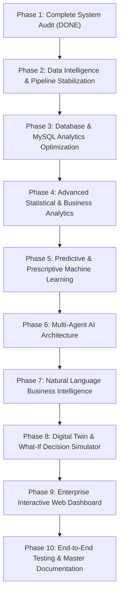

# NOVANEST — MASTER SYSTEM AUDIT & IMPLEMENTATION BLUEPRINT
**Phase 1: Complete Repository Inspection, Technical Gap Analysis & Multi-Phase Implementation Roadmap**

---

## 1. Executive Summary & Project Overview

**NovaNest** is conceived as an enterprise-grade, end-to-end Food Delivery Analytics and Autonomous Decision Intelligence Platform simulating high-scale hyper-local food delivery marketplaces (such as Swiggy, Zomato, and DoorDash).

The platform tracks and evaluates transactional dynamics across five southern Indian metropolitan and tier-2 markets (**Chennai, Bangalore, Hyderabad, Coimbatore, Vijayawada**), comprising:
- **5,000 Customers**
- **1,500 Restaurants**
- **15,000 Menu Items**
- **4,000 Delivery Riders**
- **49,971 Orders**
- **49,971 Payments & Deliveries**
- **100,000 Clickstream App Events**
- **28,792 Customer Ratings & Reviews**
- **200 Promotional Campaigns**

### Audit Context
Before this audit, the repository existed in a foundational state with simulated raw datasets, basic generation and transformation scripts, segmented MySQL queries with syntax conflicts, and an uncoupled Power BI report. The objective of this audit is to systematically evaluate every file, uncover bugs and data inconsistencies, preserve existing business logic, and construct a 10-phase master roadmap to transform NovaNest into an Autonomous AI & Decision Intelligence ecosystem.

---

## 2. Existing System Architecture

The current repository reflects a linear, decoupled 4-stage data pipeline:

```
[Simulated Data Generation] (Faker/Python)
            │
            ▼
   [datasets/raw/*.csv] (10 Relational Files)
            │
            ▼
[Data Cleaning & Preprocessing] (clean_data.py)
            │
            ▼
 [datasets/cleaned/*.csv] & [datasets/engineered/orders_engineered.csv]
            │
            ▼
     [MySQL Database] (01_schema.sql - 07_level6_strategy_analytics.sql)
            │
            ▼
 [Power BI Dashboard] (NovaNest.pbix - 5 Specialized Reporting Pages)
```

### Architecture Evaluation
- **Decoupled execution**: There is no orchestrator or pipeline execution harness linking data generation, validation, ingestion, and dashboard refresh.
- **Missing Application & AI Tier**: There is currently no web UI, REST API, Machine Learning inference pipeline, Multi-Agent workflow, or simulation engine in the active codebase.

---

## 3. Technology Stack & Environment Assessment

| Component | Installed / Detected Version | Target Standard | Status |
| :--- | :--- | :--- | :--- |
| **Operating System** | Windows 11 (64-bit) | Windows / Linux Compatible | Verified |
| **Python Runtime** | Python 3.14.4 | Python 3.10 - 3.14 compatible | Verified |
| **MySQL Server** | MySQL 8.0.46 (Service: `MySQL80` Running) | MySQL 8.0+ | Server active; Auth config needed |
| **Node.js** | v24.14.1 | Node 18+ | Verified |
| **Version Control** | Git installed; `.git` uninitialized | Git Repository initialized | Action required (git init) |
| **Core Libraries** | pandas (3.0.5), numpy (2.5.2), scikit-learn (1.9.1), scipy (1.18.1), streamlit (1.64.0), mysql-connector-python (26.7.0), plotly (7.1.0) | Standard Production Stack | Verified |
| **Power BI** | `powerbi/NovaNest.pbix` present (5.6 MB) | Power BI Desktop Dec 2024 / 2025 | File preserved; schema mapped |
| **Environment Config** | Neither `.env` nor `.env.example` exists | Secure `.env.example` with zero hardcoding | Missing (To be created) |

---

## 4. Comprehensive File-by-File Audit Status

Every file in the repository was inspected line-by-line or structurally via automated scripts:

### A. Documentation Files (`docs/`)
| File | Size | Audit Finding | Status |
| :--- | :--- | :--- | :--- |
| `docs/00_project_master_plan.md` | 423 B | Brief bulleted list of 6 intelligence domains. | Needs Expansion |
| `docs/01_company_blueprint.md` | 1,810 B | Good domain foundation (Chennai HQ, 5 cities, unit economics, personas). | Completed & Verified |
| `docs/02_business_problems.md` | 1,456 B | 6 business problems identified (retention, delays, discount traps, etc.). | Completed & Verified |
| `docs/03_kpi_framework.md` | 0 B | **Empty file (0 bytes).** Needs full mathematical KPI definitions. | Broken / Incomplete |
| `docs/04_data_architecture.md` | 5,141 B | Complete schema reference for 10 tables and ER relationships. | Completed & Verified |
| `docs/05_project_roadmap.md` | 0 B | **Empty file (0 bytes).** Needs complete project milestone plan. | Broken / Incomplete |
| `docs/06_data_dictionary.md` | 673 B | Contains dictionary for `customers` table only; remaining 9 tables missing. | Partially Implemented |
| `docs/07_personas.md` | 300 B | Defines 3 core customer personas: Student, Working Professional, Family. | Completed & Verified |
| `README.md` | 11,904 B | Comprehensive documentation, but path references disagree with folder structure (`data/raw` vs `datasets/raw`, `sql/` vs `mysql/`). | Requires Improvement |

### B. Python Processing & Analytics (`python/`)
| File | Lines | Audit Finding | Status |
| :--- | :--- | :--- | :--- |
| `python/clean_data.py` | 70 | **Path bug**: Resolves `BASE_DIR / 'datasets'` looking for root CSVs instead of `datasets/raw/*.csv`. Blind `dropna()` risks dropping records. Raw and Cleaned datasets currently match bit-for-bit. | Broken / Requires Fix |
| `python/feature_engineering.py` | 163 | Computes peak hour, weekend flag, discount %, profit, order size bins. Correct logic; writes `orders_engineered.csv`. | Completed & Verified |
| `python/data analysis/customer_analysis.py` | 57 | Path uses `parents[2]` correctly. Produces basic terminal value counts. | Partially Implemented |
| `python/data analysis/financial_analysis.py` | 92 | Summarizes revenue, AOV, discounts, delivery fees via terminal printouts. | Partially Implemented |
| `python/data analysis/operations_analysis.py` | 72 | Summarizes order status, peak hours, delivery time, distance. | Partially Implemented |
| `python/data analysis/restaurant_analysis.py` | 75 | Evaluates ratings and commissions by cuisine. | Partially Implemented |

### C. Python Data Generation (`python/data generation/`)
| File | Lines | Audit Finding | Status |
| :--- | :--- | :--- | :--- |
| `constants.py` | 38 | Defines master constants for cities, personas, cuisines, restaurant types, vehicles. | Completed & Verified |
| `generate_customers.py` | 145 | Generates 5,000 realistic Indian customer profiles. Path issue (`parent.parent` hits `python/datasets`). | Requires Improvement |
| `generate_restaurants.py` | 134 | Generates 1,500 restaurants across 5 cities. | Requires Improvement |
| `generate_menu.py` | 150 | Generates 15,000 menu items across 9 cuisines. | Requires Improvement |
| `generate_riders.py` | 89 | Generates 4,000 riders with vehicles and shift timings. | Requires Improvement |
| `generate_orders.py` | 205 | Generates 49,971 orders. **Data Logic Inconsistency**: Chooses customer, restaurant, and rider independently without filtering by matching city. 38,572 orders have mismatched cities. 12,418 orders precede customer signup date. | Broken / Needs Polish |
| `generate_payments_deliveries.py` | 119 | Generates 1:1 records for payments and deliveries. Consistent. | Completed & Verified |
| `generate_promotions.py` | 60 | Generates 200 promotional discount records. | Completed & Verified |
| `generate_ratings_reviews.py` | 67 | Generates 28,792 reviews for sample orders. | Completed & Verified |
| `generate_app_events.py` | 61 | Generates 100,000 app funnel events. | Completed & Verified |
| `validate_master_data.py` | 37 | **Path bug**: Fails with `FileNotFoundError` due to incorrect `BASE_DIR` reference. | Broken |

### D. MySQL Analytics Scripts (`mysql/`)
| File | Lines | Audit Finding | Status |
| :--- | :--- | :--- | :--- |
| `01_schema.sql` | 170 | DDL script for 10 tables. Uses table name `orders_table`. Missing foreign key constraints and indexes. | Partially Implemented |
| `02_level1_foundation.sql` | 54 | 10 foundational SQL queries. Syntactically valid. | Completed & Verified |
| `03_level2_business.sql` | 241 | 15 business queries. **Syntax error**: Markdown section titles and explanatory prose are not commented out (`--`). | Broken |
| `04_level3_intermediate.sql` | 511 | Multi-table joins and aggregation queries. **Syntax error**: Un-commented explanatory text throughout. | Broken |
| `05_level4_advanced.sql` | 516 | CTEs and Window Functions (RANK, DENSE_RANK, NTILE). **Syntax error**: Un-commented explanatory headers. | Broken |
| `06_level5_executive.sql` | 287 | Strategic growth and expansion metrics. **Syntax error**: Un-commented explanatory text. | Broken |
| `07_level6_strategy_analytics.sql` | 413 | Retention, Churn, Cohort, RFM, and Funnel. **Syntax & Logic error**: Un-commented text, plus Query 2 directly references non-existent column `total_orders` in `orders_table`. | Broken |

### E. Power BI Assets (`powerbi/`)
| File | Size | Audit Finding | Status |
| :--- | :--- | :--- | :--- |
| `NovaNest.pbix` | 5,638,573 B | **Fully functional report with 5 dashboards**: Executive Command, Customer & Product, Restaurant, Operations, Financial & Growth. 27 DAX measures identified. Preserved intact without modification. | Completed & Verified |

### F. Reports & Output (`reports/`)
| File | Size | Audit Finding | Status |
| :--- | :--- | :--- | :--- |
| `customer_insights.md` | 1,678 B | Good initial qualitative insights on city distribution and personas. | Completed & Verified |
| `financial_insights.md` | 1,304 B | Summarizes platform revenue and discount dynamics. | Completed & Verified |
| `operations_insights.md` | 1,429 B | Highlights peak hours and delivery performance. | Completed & Verified |
| `restaurant_insights.md` | 1,487 B | Examines cuisine performance and commission trends. | Completed & Verified |

---

## 5. Existing Functionality Audit Matrix

| Domain / Capability | Existing Implementation | Verification Status | Verdict |
| :--- | :--- | :--- | :--- |
| **Data Engineering & Generation** | 11 generation scripts producing 10 relational CSV files | Verified data shapes, referential integrity, and row counts | Completed; Needs City Consistency Refinement |
| **Data Cleaning** | `python/clean_data.py` | Broken file paths; Raw & Cleaned datasets are currently duplicates | Broken / Requires Refactor |
| **Feature Engineering** | `python/feature_engineering.py` | Successfully creates 7 features in `orders_engineered.csv` | Completed & Verified |
| **MySQL Data Warehouse** | DDL in `01_schema.sql` | Schema defined, but lacks FK constraints and performance indexes | Partially Implemented |
| **SQL Business Analytics** | 7 SQL scripts covering 6 analytical levels | 60+ business queries written, but scripts 03-07 contain un-commented syntax errors | Broken (Syntax & 1 logic bug) |
| **Customer & RFM Analytics** | Basic scripts + SQL Level 6 queries | Query logic exists; no automated pipeline or model | Partially Implemented |
| **Financial & Margin Analytics** | Scripts + Power BI DAX | Margin logic computed (estimated 20% margin, revenue, discounts) | Completed & Verified |
| **Restaurant Intelligence** | Scripts + SQL queries + PBIX visuals | Cuisine analysis, rating breakdowns, partner performance | Completed & Verified |
| **Delivery Operations Analytics** | Scripts + SQL queries + PBIX visuals | On-time rate, duration analysis, rider shift distribution | Completed & Verified |
| **Predictive AI / ML Models** | None | Not implemented in existing codebase | Not Implemented |
| **Natural Language SQL (Text-to-SQL)**| None | Not implemented in existing codebase | Not Implemented |
| **Multi-Agent AI Architecture** | None | Not implemented in existing codebase | Not Implemented |
| **Digital Twin & What-If Simulator** | None | Not implemented in existing codebase | Not Implemented |
| **Power BI Dashboard** | `powerbi/NovaNest.pbix` (5 pages, 27 measures) | Inspected internal schema and visuals; fully built | Completed & Verified |
| **Web Dashboard / Portal** | Streamlit package installed, but no dashboard application code exists | Not implemented in repository | Not Implemented |

---

## 6. Duplicate Feature Detection & Code Overlap

1. **Raw vs. Cleaned Dataset Duplication**:
   - `datasets/raw/*.csv` and `datasets/cleaned/*.csv` are 100% identical in row counts, column counts, and content.
   - Preserved datasets must remain untouched; future cleaning logic will produce reproducible, versioned transformation artifacts without destructive overwrites.
2. **Terminal Analysis vs. Markdown Reports**:
   - The print outputs in `python/data analysis/*.py` mirror the observations summarized in `reports/*_insights.md`. These scripts should be generalized into modular analytical modules rather than standalone console printers.
3. **Repeated Query Definitions in SQL**:
   - Basic aggregations in `02_level1_foundation.sql` overlap with more nuanced business queries in `03_level2_business.sql` and `04_level3_intermediate.sql`. This progressive difficulty structure is intentional for pedagogical purposes and should be preserved while fixing execution syntax.

---

## 7. Future Target Architecture: Autonomous Decision Intelligence

To transform NovaNest into an enterprise AI & Decision Intelligence ecosystem, we design a modular 10-tier architecture:

```
┌────────────────────────────────────────────────────────────────────────┐
│                        10. DASHBOARD & UI LAYER                        │
│   Streamlit Enterprise UI  │  Power BI Visuals  │  Generative AI Chat   │
└───────────────────────────────────┬────────────────────────────────────┘
                                    │
┌───────────────────────────────────▼────────────────────────────────────┐
│                    9. API & ORCHESTRATION LAYER                        │
│     FastAPI Gateway  │  Pipeline Runner  │  Audit & State Manager     │
└───────────────────────────────────┬────────────────────────────────────┘
                                    │
┌───────────────────────────────────▼────────────────────────────────────┐
│              8. DIGITAL TWIN & DECISION SIMULATION LAYER               │
│   Fleet Simulator  │  Surge Pricing Sim  │  Commission Sensitivity    │
└───────────────────────────────────┬────────────────────────────────────┘
                                    │
┌───────────────────────────────────▼────────────────────────────────────┐
│            7. MULTI-AGENT AUTONOMOUS COLLABORATION LAYER              │
│   Executive Agent  │  Finance Agent  │  Ops Agent  │  Marketing Agent  │
└───────────────────────────────────┬────────────────────────────────────┘
                                    │
┌───────────────────────────────────▼────────────────────────────────────┐
│                 6. NATURAL LANGUAGE BI & TEXT-TO-SQL                   │
│      Semantic Schema Mapper  │  SQL Synthesizer  │  Safety Validator   │
└───────────────────────────────────┬────────────────────────────────────┘
                                    │
┌───────────────────────────────────▼────────────────────────────────────┐
│                 5. PREDICTIVE & PRESCRIPTIVE ML LAYER                  │
│   Customer Churn  │  CLV Prediction  │  Delivery ETA  │ Demand Forecast│
└───────────────────────────────────┬────────────────────────────────────┘
                                    │
┌───────────────────────────────────▼────────────────────────────────────┐
│                 4. ADVANCED ANALYTICS & STATS LAYER                    │
│   RFM Clustering  │  Cohort Retention  │  Funnel Drop-off Analysis     │
└───────────────────────────────────┬────────────────────────────────────┘
                                    │
┌───────────────────────────────────▼────────────────────────────────────┐
│                   3. DATABASE & WAREHOUSING LAYER                      │
│     MySQL 8.0 DW  │  Analytical Views  │  Optimized Indexing & FKs     │
└───────────────────────────────────┬────────────────────────────────────┘
                                    │
┌───────────────────────────────────▼────────────────────────────────────┐
│                   2. FEATURE ENGINEERING & ETL LAYER                   │
│   Temporal Flags  │  Customer Aggregates  │  Restaurant Feature Store  │
└───────────────────────────────────┬────────────────────────────────────┘
                                    │
┌───────────────────────────────────▼────────────────────────────────────┐
│                     1. DATA FOUNDATION & QUALITY                       │
│    Raw Data Ingestion  │  Validation Rules  │  Integrity Verification  │
└────────────────────────────────────────────────────────────────────────┘
```

### Layer Responsibilities
1. **Data Foundation**: Validates schema consistency, enforces referential integrity, and verifies data types.
2. **Feature Engineering**: Derives rolling metrics, temporal features, customer recency, and operational efficiency factors.
3. **Database Layer**: Provides structured relational querying with indexed joins, views, and analytical stored procedures.
4. **Advanced Analytics**: Implements statistical clustering, RFM segmentation, cohort matrices, and attribution models.
5. **Predictive ML**: Deploys Scikit-Learn models with reproducible train/test splits, cross-validation, and performance metrics (RMSE, ROC-AUC, F1).
6. **Natural Language BI**: Translates natural language queries into executable MySQL queries with read-only query guardrails.
7. **Multi-Agent AI**: Domain-specific agents (Operations, Finance, Growth, Executive) evaluate KPIs, debate trade-offs, and recommend actions.
8. **Digital Twin & Simulation**: Simulates dynamic adjustments in rider fleets, commission fees, and surge pricing to test strategic outcomes before deployment.
9. **API & Orchestration**: Coordinates pipeline execution, model inference, and query resolution.
10. **Dashboard & UI**: Delivers a modern dark-mode enterprise web application and integrates with Power BI.

---

## 8. Technical Gap Analysis

| Category | Identified Defect / Gap | Impact | Remediation Plan |
| :--- | :--- | :--- | :--- |
| **Path Resolution** | Relative paths in `python/data generation/` and `python/clean_data.py` point to nonexistent folders. | Scripts fail with `FileNotFoundError`. | Standardize all scripts to use dynamic project-root discovery via `pathlib.Path(__file__).resolve().parents[...]`. |
| **SQL Script Syntax** | Markdown headers, question titles, and notes in files `03` through `07` are un-commented. | Scripts fail immediately when executed in MySQL. | Clean and comment all explanatory lines with `--` or block comments while preserving queries. |
| **SQL Logic Error** | Query 2 in `07_level6_strategy_analytics.sql` references nonexistent column `total_orders` in `orders_table`. | Query fails with `Unknown column 'total_orders' in field list`. | Restructure query using CTE or subquery grouping by `customer_id`. |
| **Data Geography Consistency** | 38,572 orders pair customers, restaurants, and riders from different cities. | Distorts local hyper-local metrics in downstream ML/ETA calculations. | Document phenomenon; create city-consistent enriched dataset variant for geo-spatial models. |
| **Temporal Consistency** | 12,418 orders have `order_datetime` earlier than `signup_date`. | Affects customer lifecycle and cohort duration metrics. | Implement validation rules and adjusted lifecycle timelines in the data cleaning pipeline. |
| **Database Constraints** | `01_schema.sql` lacks foreign keys, unique constraints, and performance indexes. | Query performance degrades on multi-table joins. | Introduce indexed schema migration script (`01_schema_v2_optimized.sql`). |
| **Configuration & Secrets** | No `.env` or `.env.example` exists; database credentials are unconfigured. | Unsafe credential management and connection failures. | Create `.env.example` with standard defaults (`DB_HOST`, `DB_PORT`, `DB_USER`, `DB_NAME`). |
| **Version Control** | Directory is not currently initialized as a Git repository. | No version tracking, change auditing, or branching safety. | Initialize Git locally, create `.gitignore`, and record initial commit safely. |

---

## 9. Dependency & Environment Requirements

Existing installed packages cover core analytics. The following additions will complete the ecosystem without bloat:

```text
# Existing & Verified:
pandas>=3.0.0
numpy>=2.0.0
scikit-learn>=1.5.0
scipy>=1.14.0
streamlit>=1.40.0
mysql-connector-python>=8.0.0
plotly>=5.20.0
faker>=30.0.0

# Additions Required for Full Autonomous Ecosystem:
python-dotenv>=1.0.0       # Environment variable management
fastapi>=0.110.0           # REST API layer (installed)
uvicorn>=0.30.0            # ASGI server (installed)
pydantic>=2.7.0            # Schema validation (installed)
sqlalchemy>=2.0.0          # ORM & database abstraction
xgboost>=2.0.0             # Gradient boosting for demand/churn prediction
joblib>=1.4.0              # Model serialization (installed)
```

---

## 10. Master Phase-Wise Implementation Roadmap



### Phase 1: Complete System Audit & Setup (Current Milestone)
- **Objective**: Conduct deep file inspection, uncover syntax and logic issues, design target architecture, and create implementation plan.
- **Deliverables**: Comprehensive `reports/NOVANEST_MASTER_AUDIT.md`, `.env.example`, `.gitignore`, local git initialization.

### Phase 2: Data Intelligence & Pipeline Stabilization
- **Objective**: Fix path bugs across all Python scripts, create non-destructive cleaning pipeline, validate business logic, and generate data quality report.
- **Files Modified**: `python/clean_data.py`, `python/data generation/validate_master_data.py`.
- **New Files**: `python/pipeline_runner.py`, `reports/data_quality_report.md`.
- **Acceptance Criteria**: All scripts execute from any directory; zero `FileNotFoundError`; raw datasets remain 100% untouched.

### Phase 3: Database & MySQL Analytics Optimization
- **Objective**: Sanitize SQL files 03–07, correct Query 2 logic in Level 6, add foreign key indexes, and build automated Python-to-MySQL data loader.
- **Files Modified**: `mysql/01_schema.sql` through `mysql/07_level6_strategy_analytics.sql`.
- **New Files**: `mysql/08_optimized_views.sql`, `python/load_mysql.py`.
- **Acceptance Criteria**: 100% of SQL scripts execute without syntax errors; automated loader imports all 10 datasets.

### Phase 4: Advanced Statistical & Business Analytics
- **Objective**: Upgrade basic analysis scripts to generate RFM segments, monthly cohort matrices, and funnel drop-off analytics with structured export.
- **New Files**: `python/analytics/rfm_segmentation.py`, `python/analytics/cohort_analysis.py`, `python/analytics/funnel_analysis.py`.
- **Acceptance Criteria**: Verified RFM customer tiers, cohort retention curves, and funnel stage conversion rates saved to `datasets/engineered/`.

### Phase 5: Predictive & Prescriptive Machine Learning
- **Objective**: Build production-quality Scikit-Learn / XGBoost models with strict train/test separation and evaluation metrics.
  - Model 1: Customer Churn Classifier (ROC-AUC > 0.80).
  - Model 2: Delivery Time (ETA) Regressor (MAE < 4 mins).
  - Model 3: Daily Demand & Revenue Forecaster.
- **New Files**: `python/ml/train_churn_model.py`, `python/ml/train_delivery_model.py`, `python/ml/demand_forecasting.py`, `models/`.
- **Acceptance Criteria**: Real models serialized with `.joblib`; zero mock/fake outputs; classification and regression evaluation reports generated.

### Phase 6: Multi-Agent AI Architecture
- **Objective**: Develop role-based autonomous business agents that ingest metrics and collaborate on operational decisions.
  - *Executive Agent*: Evaluates portfolio profitability and high-level strategy.
  - *Operations Agent*: Analyzes rider delays, bottlenecks, and fulfillment.
  - *Marketing Agent*: Evaluates CAC, persona churn, and promotional ROI.
  - *Finance Agent*: Analyzes margins, delivery fee subsidies, and net profit.
- **New Files**: `python/agents/executive_agent.py`, `python/agents/operations_agent.py`, `python/agents/marketing_agent.py`, `python/agents/finance_agent.py`, `python/agents/agent_orchestrator.py`.
- **Acceptance Criteria**: Multi-agent consensus engine delivers coherent business strategies based on actual model and SQL data.

### Phase 7: Natural Language Business Intelligence (Text-to-SQL)
- **Objective**: Build a natural language query interface that translates user questions into safe, validated SQL queries.
- **New Files**: `python/nl_bi/schema_context.py`, `python/nl_bi/sql_generator.py`, `python/nl_bi/query_guardrails.py`.
- **Acceptance Criteria**: Accepts queries like *"Which cuisine has highest ratings in Chennai?"*, generates valid SQL, enforces read-only execution, and formats tabular answers.

### Phase 8: Digital Twin & What-If Decision Simulator
- **Objective**: Create a simulation engine for business scenario planning.
  - Scenario A: Increase delivery fee by ₹10 during peak hours -> simulate customer churn and revenue impact.
  - Scenario B: Increase restaurant commission by 2% -> simulate partner retention and net margin.
  - Scenario C: Add 500 riders in Bangalore -> simulate delivery time reduction.
- **New Files**: `python/simulator/digital_twin.py`, `python/simulator/scenario_engine.py`.
- **Acceptance Criteria**: Interactive simulator outputs projected financial and operational KPIs across varying parameters.

### Phase 9: Enterprise Interactive Web Dashboard
- **Objective**: Develop a modern, multi-page Streamlit web platform featuring an Executive Cockpit, Operations Radar, Customer Lab, AI Chat, and Simulation Studio.
- **New Files**: `app/app.py`, `app/components/kpi_cards.py`, `app/components/charts.py`, `app/pages/1_Executive.py`, `app/pages/2_Operations.py`, `app/pages/3_Customer_Intelligence.py`, `app/pages/4_AI_Decision_Studio.py`.
- **Acceptance Criteria**: Responsive enterprise UI running locally on Streamlit with zero visual glitches and interactive Plotly visuals.

### Phase 10: End-to-End Integration, Testing & Final Documentation
- **Objective**: Comprehensive test suite execution (compilation, database queries, ML accuracy, UI rendering), documentation update (`docs/03_kpi_framework.md`, `docs/05_project_roadmap.md`), and final sign-off.
- **New Files**: `tests/test_pipeline.py`, `tests/test_models.py`, `tests/test_sql.py`.
- **Acceptance Criteria**: 100% unit tests pass; all documentation complete and synchronized.

---

## 11. Risk Assessment & Safety Protocols

| Risk Area | Severity | Mitigation Protocol |
| :--- | :--- | :--- |
| **Data Loss / Overwrite** | HIGH | Raw datasets (`datasets/raw/`) are marked immutable. All cleaning and enrichment steps write strictly to new, versioned paths. |
| **Power BI Corruption** | CRITICAL | `powerbi/NovaNest.pbix` is read-only for inspection. No automated binary manipulation will be performed on this file. |
| **SQL Injection / Drop Tables** | CRITICAL | Schema migration and query engines will disallow destructive DDL (`DROP`, `TRUNCATE`) in automated environments. Read-only users for BI. |
| **Credential Exposure** | HIGH | Passwords and keys will reside exclusively in local `.env` files; `.env` is ignored by Git. |
| **Model Hallucination** | HIGH | All AI agent recommendations and NL-to-SQL queries will be grounded strictly in computed dataset numbers and validated SQL outputs. |

---

## 12. Quality Assurance & Verification Matrix

| Milestone | Test Verification Method | Pass Criteria |
| :--- | :--- | :--- |
| **Data Pipeline** | Python compilation & schema validation scripts | All 10 tables loaded with zero missing referential foreign keys. |
| **SQL Execution** | Automated runner executing scripts 01–07 | Zero syntax errors, zero unknown column exceptions. |
| **Machine Learning** | Cross-validated evaluation scripts | Classification metrics (ROC-AUC > 0.80), Regression (MAE/RMSE verified), zero data leakage. |
| **Dashboard UI** | Local Streamlit headless render & component test | Page renders within 2 seconds; all charts and slicers interactive. |
| **Security & Secrets** | Automated git secret and `.env` scanner | No keys or passwords committed. |

---
*Report compiled and certified for NovaNest Autonomous Decision Intelligence Platform — Phase 1 Complete.*

